# Me Conta · API

### Integrantes

| Nome | RM | Turma |
|---|---|---|
| Nicoli Amy Kassa | RM 559104 | 3ESPW |

---
<br>

> O app que troca o 👍 da família por uma pergunta que só os avós sabem responder.

Backend do **Me Conta**, desenvolvido para a Global Solution FIAP 2026 (CitizenTech). Uma única Web API em **C# / .NET 10** atende **C# Software Development** e **SOA e Web Services**. Ela guarda famílias, idosos, perguntas e o caderno de memórias da família, e é consumida pelo app mobile (Expo).

| | |
|---|---|
| 🎬 **Pitch** | [**Assistir no YouTube**](https://youtu.be/INSERIR-LINK-DO-PITCH) |
| 📄 **Documentação da API** | `/swagger` e `/scalar` (com a API rodando) |
| 🧪 **Testes** | `dotnet test` (103 testes) | 

---

## Ficha da CitizenTech

| Campo | Resposta |
|---|---|
| **Nome da CitizenTech** | Me Conta |
| **Cidade e bairro** | São Paulo (SP). Bairro piloto: Pirituba, zona norte |
| **Cidadão beneficiado** | Pessoas idosas, com mais de 60 anos, especialmente as que moram sozinhas, e seus netos e filhos. Pelo modo "Ensine sua avó", também os idosos que ainda não usam o celular. |
| **Problema em uma frase** | Os avós guardam receitas, histórias da família e memórias do bairro que ninguém mais tem, mas, quando mandam um "bom dia" no grupo da família, recebem de volta um 👍 e nenhuma pergunta. |
| **A solução** | O Me Conta é um aplicativo que troca o 👍 da família por uma pergunta que só os avós sabem responder. |
| **Como funciona** | O neto escolhe uma pergunta no app (receitas, história da família, ofícios, o bairro, conselhos). O app abre o WhatsApp com a mensagem pronta. O avô responde por áudio, do jeito que já sabe. A resposta vira uma memória, e vai para a página do caderno da família, com áudio, foto e título. O idoso volta a ser quem ensina e lembra. |
| **Link do repositório** | [Me Conta API - GitHub](https://github.com/Nicoli-Kassa/GS-CitizenTech_CSharpSOA_MeConta) |
| **Indicador de impacto** | Conversas de verdade por semana: % de idosos que respondem pelo menos uma pergunta da família por semana. Indicadores de apoio: minutos de áudio guardados no caderno de cada família e % de idosos que passam a responder sem ajuda depois do modo "Ensine sua avó". |
| **ODS conectados** | **ODS 10**, meta 10.2 (inclusão social de todos, independentemente da idade) · **ODS 11**, meta 11.4 (proteger o patrimônio cultural, aqui a memória do bairro) · **ODS 3**, meta 3.4 (bem-estar mental, pelo vínculo e não por cuidado de saúde) |

---

## Sumário

1. [O problema](#o-problema)
2. [A solução](#a-solução)
3. [Contribuição para os ODS](#contribuição-para-os-ods)
4. [O que esta API faz](#o-que-esta-api-faz)
5. [Arquitetura](#arquitetura)
6. [Modelo de domínio e POO](#modelo-de-domínio-e-poo)
7. [Banco de dados e migrações](#banco-de-dados-e-migrações)
8. [Endpoints](#endpoints)
9. [Regras de negócio](#regras-de-negócio)
10. [Como executar](#como-executar)
11. [Testes automatizados](#testes-automatizados)
12. [Evidências](#evidências)
13. [Privacidade e segurança](#privacidade-e-segurança)
14. [Tecnologias](#tecnologias)
15. [Próximos passos](#próximos-passos)

---

## O problema

Pense na sua avó. Ela sabe de cor a receita do bolo de domingo, lembra como era o bairro quando a rua ainda era de terra e guarda histórias da família que mais ninguém conhece. Toda manhã, ela manda um "bom dia" no grupo da família. A resposta, quando vem, é um 👍.

Antes, falar com quem morava longe custava caro. Cada minuto de ligação pesava na conta de telefone, e por isso era bem usado. Hoje, a avó está a um clique de distância, de graça, a qualquer hora. E a conversa encolheu até caber num emoji.

**Não é falta de amor. É falta de assunto.** A família quer estar perto, mas não sabe o que dizer além de um 👍. Do outro lado, fica alguém com uma vida inteira para contar, esperando uma pergunta que não chega.

| Dado | Fonte |
|---|---|
| **32,1 milhões** de pessoas com 60 anos ou mais no Brasil | IBGE, Censo 2022 |
| **5,7 milhões** de idosos moram sozinhos | IBGE, Censo 2022 |
| A solidão está associada a cerca de **871 mil mortes por ano**, perto de **100 por hora**, e afeta **1 em cada 6 pessoas** | OMS, Comissão de Conexão Social (jun/2025) |
| **9,1 milhões** de idosos brasileiros não usam a internet; **66,5%** deles porque não sabem usar | IBGE, PNAD Contínua TIC 2025 (9,1 mi = cálculo próprio sobre os microdados) |
| **4,9 milhões** desses idosos desconectados moram com alguém que usa a internet | Cálculo próprio sobre os microdados da PNAD TIC 2025 |
| O contato digital **complementa**, mas não substitui, o contato presencial | Fu et al., 2023 |

Existe ainda uma perda silenciosa. Cada história que ninguém pergunta é uma história que um dia vai embora com quem a viveu: a receita que nunca foi anotada, o nome antigo da rua, o jeito como a família começou. Quando alguém finalmente pensar em perguntar, pode ser tarde demais.

## A solução

**Se falta assunto, o Me Conta tem de monte.**

O Me Conta troca o 👍 por uma pergunta que só a avó sabe responder: *"Vó, qual era o segredo do seu bolo de domingo?"*, *"Como era o bairro quando a senhora chegou?"*, *"Qual foi o melhor conselho que a senhora já recebeu?"*

A Bia, de 19 anos, abre o app e escolhe uma pergunta. Com um toque, a pergunta abre no WhatsApp da Dona Lourdes, pronta para enviar. A Dona Lourdes não precisa baixar nada nem aprender nada novo: responde com um áudio, como sempre fez. Esse áudio vira uma página do caderno da família, com título, foto e a voz dela, guardada para os netos, os bisnetos e quem vier depois.

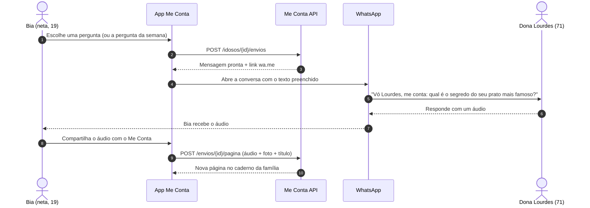

O Me Conta cresce em três degraus:

| Degrau | O que faz | Situação no protótipo |
|---|---|---|
| **1. Conectar** | O modo "Ensine sua avó" transforma o neto em professor, passo a passo, até o primeiro áudio enviado. | API registra quem concluiu o roteiro (`RespondeSozinho`) |
| **2. Aprofundar** | O coração do app: a pergunta, a resposta e o caderno da família. | **Funciona de ponta a ponta** |
| **3. Expandir** | Com permissão e após um filtro de dados pessoais, memórias vão para o mapa do bairro. | Visão de futuro |

O Me Conta não substitui a visita de domingo. O objetivo é que, na próxima visita, a família tenha muito mais assunto.

## Contribuição para os ODS

| ODS | Meta | Como o Me Conta contribui |
|---|---|---|
| **10. Redução das desigualdades** | 10.2 · Promover a inclusão social de todos, independentemente da idade | Coloca o idoso no centro da conversa da família como quem ensina, e o modo "Conectar" ajuda quem ainda está fora da internet. |
| **11. Cidades e comunidades sustentáveis** | 11.4 · Proteger o patrimônio cultural | Guarda receitas, ofícios e memórias do bairro que hoje se perdem por falta de registro. |
| **3. Saúde e bem-estar** | 3.4 · Promover a saúde mental e o bem-estar | Atua pelo vínculo: mais conversa de verdade e menos isolamento, sem ser um app de saúde. |

---

## O que esta API faz

- Cadastro de **famílias**, **membros** (neta, filha) e **idosos**, com entrada de parentes por **código de convite** de 48 horas.
- **Catálogo de 25 perguntas** em 5 categorias, **pergunta da semana** para cada idoso e **perguntas próprias** da família, com **filtro anti-golpe** (bloqueia pedidos de PIX, dinheiro, senha ou código).
- **Envio pelo WhatsApp**: registra o envio e devolve a mensagem pronta e o link `wa.me`, com acentos e emojis codificados.
- **Caderno da família**: upload do áudio da resposta (e foto opcional), listagem paginada com filtros, áudio para ouvir no app e exclusão pela pessoa que criou a página.
- **Modo offline**: o app manda uma chave de idempotência; se reenviar a mesma página, a API devolve a que já existe e não duplica.
- **Indicador de impacto** "Conversas de verdade" da semana.
- **Login** com ASP.NET Identity (token Bearer) e regra de acesso: só a família vê os dados da família.

## Arquitetura

A solução segue uma arquitetura em camadas, com a regra de dependência garantida pelo compilador: cada camada é um projeto e só referencia as camadas internas.

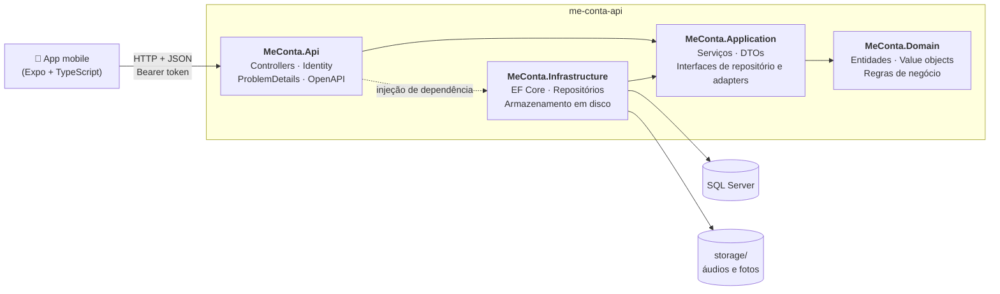

| Projeto | Responsabilidade | Depende de |
|---|---|---|
| `MeConta.Domain` | Entidades, value objects, exceções e regras de negócio puras. Nenhum pacote externo. | — |
| `MeConta.Application` | Casos de uso (serviços), DTOs e as interfaces que a infraestrutura implementa (`IRepository<T,TId>`, `IUnidadeDeTrabalho`, `IArmazenamentoDeArquivos`, `IUsuarioAtual`...). | Domain |
| `MeConta.Infrastructure` | `AppDbContext` (EF Core + Identity), configurações Fluent API, migrações, repositórios, consultas LINQ e adapters de disco e de código de convite. | Application |
| `MeConta.Api` | Controllers REST, autenticação, tratamento de erros, documentação OpenAPI, health check e composição da injeção de dependência. | Application, Infrastructure |

```
me-conta-api/
├── README.md 
├── MeConta.slnx
├── Directory.Build.props        ← net10.0, nullable, implicit usings
├── docs/evidencias/             ← prints usados neste README
├── src/
│   ├── MeConta.Domain/          Comum · Entidades · Enums · Excecoes · Regras · ValueObjects
│   ├── MeConta.Application/     Abstracoes · Adapters · Dtos · Excecoes · Servicos
│   ├── MeConta.Infrastructure/  Adapters · Persistencia (Configuracoes, Migrations) · Repositorios
│   └── MeConta.Api/             Adapters · Configuracao · Controllers · Program.cs · MeConta.Api.http
└── tests/
    └── MeConta.UnitTests/       Domain · Regras
```

## Modelo de domínio e POO

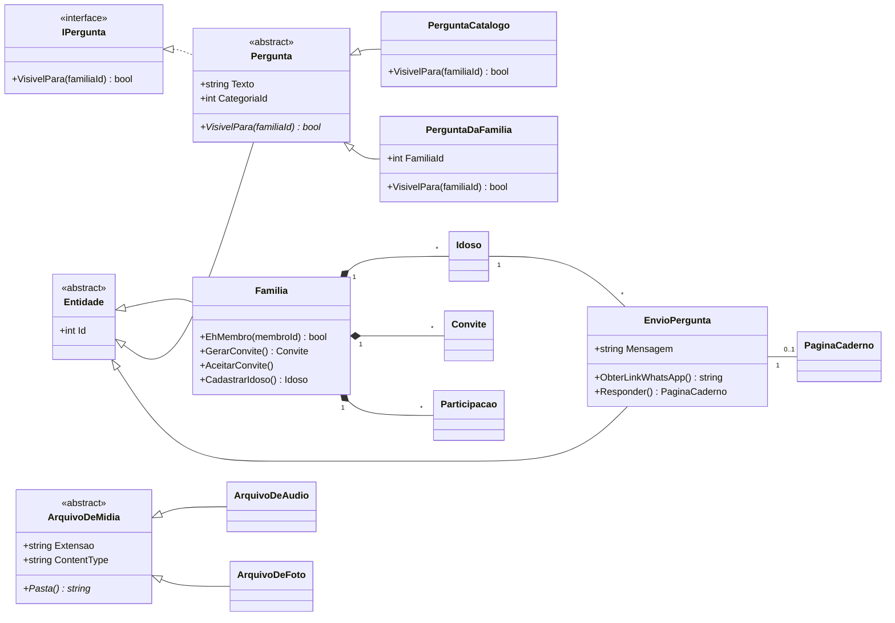

| Pilar | Onde aparece |
|---|---|
| **Abstração** | `IPergunta`, `Pergunta` e `ArquivoDeMidia` são abstratas; serviços dependem de interfaces (`IFamiliaService`, `IPaginaRepository`...). |
| **Herança** | `Entidade` → todas as entidades; `Pergunta` → `PerguntaCatalogo` / `PerguntaDaFamilia`; `ArquivoDeMidia` → `ArquivoDeAudio` / `ArquivoDeFoto`; `RegraDeNegocioException` → `ConflitoException` / `ArquivoMuitoGrandeException`. |
| **Polimorfismo** | `VisivelPara(familiaId)`: o catálogo é visível para todos, a pergunta da família só para ela. Cada tipo de arquivo define formatos, limite e mensagens (template method no construtor da classe base). |
| **Encapsulamento** | Setters privados, construtores que validam, coleções expostas como `IReadOnlyCollection`. Só a `Familia` cadastra idosos (garante o WhatsApp único) e só o `EnvioPergunta` cria páginas (garante uma resposta por pergunta). |
| **Value objects** | `Telefone` (normaliza para 55 + DDD + número), `Semana` (segunda a domingo, no fuso de Brasília). |
| **Interfaces e injeção de dependência** | Repositórios, serviços, `IFiltroAntiGolpe`, `ISugestaoSemanal`, `IArmazenamentoDeArquivos`, `IGeradorDeCodigoConvite`, `IUsuarioAtual` e `TimeProvider` (relógio injetável), todos registrados no contêiner do ASP.NET Core. |

## Banco de dados e migrações

- **SQL Server** com Entity Framework Core 10 (LocalDB no desenvolvimento).
- As tabelas do login (`AspNetUsers`...) vêm do ASP.NET Identity, no mesmo `AppDbContext`.
- **Fluent API** em `Persistencia/Configuracoes`: tamanhos, chaves, índices únicos, enums gravados como texto, conversores de valor e regras de exclusão.
- **Herança TPH**: as duas perguntas ficam na tabela `Perguntas`, separadas pela coluna `Origem`.
- **Seed na migração** (`HasData`): 5 categorias e 25 perguntas.
- **Migrações** aplicadas automaticamente ao subir a API (`MigrateAsync`).
- **LINQ** nas duas sintaxes: consulta (`from ... join ... select`) nas famílias do membro e no indicador; métodos (`Where`, `Include`, `OrderByDescending`, `Skip/Take`, `SumAsync`) no caderno paginado.
- Todo o acesso ao banco é **assíncrono** (`async/await` com `CancellationToken` do controller até o EF Core).

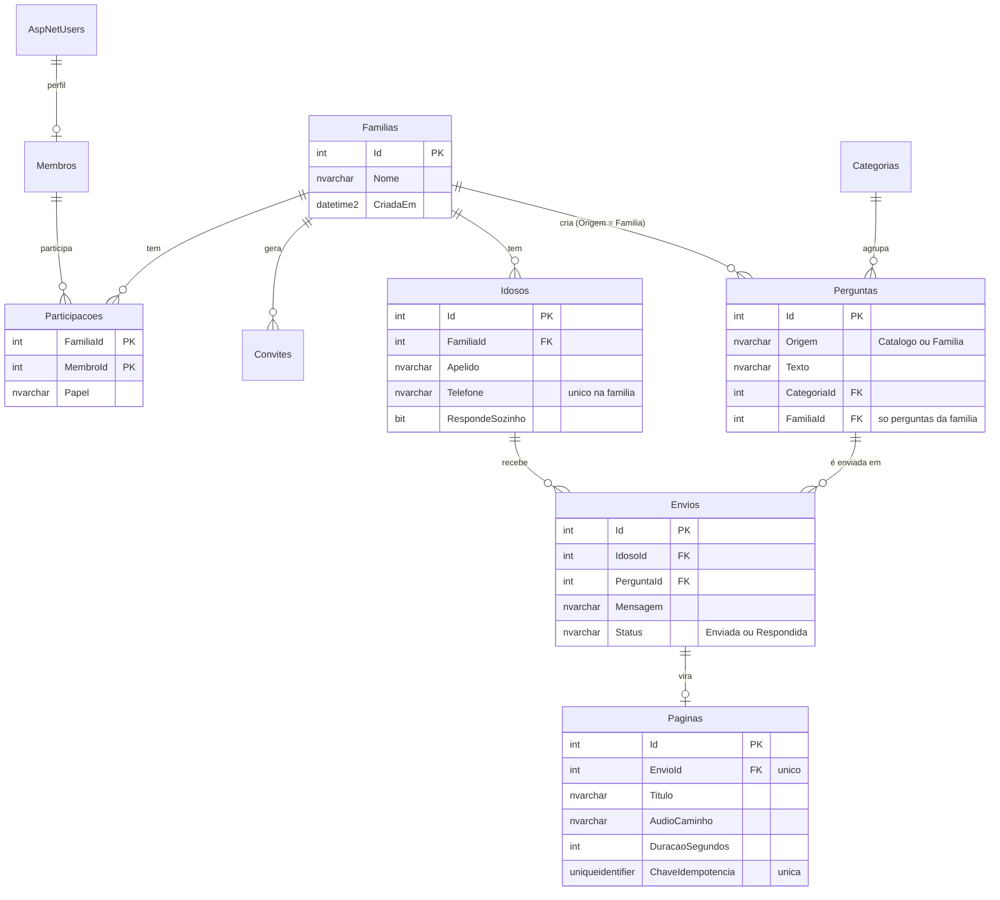

## Endpoints

Todas as rotas ficam em `/api/v1` e, exceto login, cadastro e categorias, exigem o token Bearer. Os erros seguem o padrão **ProblemDetails** (RFC 9457), com a mensagem pronta para o app mostrar no campo `detail`.

| Método | Rota | User story | Respostas |
|---|---|---|---|
| POST | `/auth/register` · `/auth/login` | Login | 200 · 400 · 401 |
| POST | `/membros` | Perfil | 201 · 400 · 409 |
| GET | `/membros/eu` | Perfil | 200 · 403 |
| POST | `/familias` | US01 | 201 · 400 |
| GET | `/familias` · `/familias/{familiaId}` | US01 | 200 · 403 · 404 |
| POST | `/familias/{familiaId}/convites` | US03 | 201 · 403 |
| POST | `/convites/{codigo}/aceitar` | US03 | 200 · 400 |
| POST · GET | `/familias/{familiaId}/idosos` | US02 | 201 · 200 · 400 · 409 |
| GET · PUT | `/idosos/{idosoId}` | US02 | 200 · 400 · 403 · 404 · 409 |
| POST | `/idosos/{idosoId}/roteiro-concluido` | US14 | 200 |
| GET | `/categorias` | US04 | 200 |
| GET | `/idosos/{idosoId}/perguntas?categoria=` | US04 | 200 · 404 |
| GET | `/idosos/{idosoId}/pergunta-da-semana` | US05 | 200 · 204 |
| POST | `/familias/{familiaId}/perguntas` | US06 | 201 · 400 |
| POST · GET | `/idosos/{idosoId}/envios` | US07 | 201 · 200 · 404 · 409 |
| POST | `/envios/{envioId}/pagina` (multipart) | US08 · US10 | 201 · 200 · 400 · 409 · 413 |
| GET | `/familias/{familiaId}/caderno?idosoId=&categoria=&pagina=&tamanho=` | US09 | 200 · 403 |
| GET | `/paginas/{paginaId}` · `/audio` · `/foto` | US09 | 200 · 403 · 404 |
| DELETE | `/paginas/{paginaId}` | US11 | 204 · 403 |
| GET | `/indicadores/conversas-de-verdade?data=` | US12 | 200 |
| GET | `/health` | Monitoramento | 200 · 503 |

## Regras de negócio

| Regra | Onde fica | Resposta |
|---|---|---|
| Nome da família obrigatório, até 60 caracteres | `Familia` | 400 "Dê um nome para a família" |
| WhatsApp com DDD, salvo como 55 + DDD + número | `Telefone` | 400 "Confira o número do WhatsApp" |
| O mesmo WhatsApp não se repete na família | `Familia` + índice único | 409 "Esse número já está na família" |
| Convite com 6 caracteres, válido por 48 horas | `Convite` | 400 "Código inválido ou expirado. Peça um novo." |
| Pergunta da família com 10 a 200 caracteres, sem pedido de PIX, dinheiro, senha ou código | `PerguntaDaFamilia` + `FiltroAntiGolpe` | 400 "O Me Conta não envia pedidos de dinheiro ou senhas" |
| Pergunta da semana muda toda segunda e nunca repete uma já enviada | `SugestaoSemanal` + `Semana` | 204 quando o catálogo acabou |
| Sem WhatsApp cadastrado, não há envio | `EnvioPergunta` | 409 "Cadastre o WhatsApp" |
| Áudio mp3, m4a, ogg ou opus, até 20 MB; foto até 10 MB | `ArquivoDeAudio` · `ArquivoDeFoto` | 400 · 413 |
| Uma resposta por pergunta enviada | `EnvioPergunta.Responder` | 409 "Essa pergunta já foi respondida" |
| Mesma chave de idempotência não duplica a página | `CadernoService` + índice único | 200 com a página existente |
| Só a família vê o caderno; só quem criou apaga a página | `ControleDeAcesso` · `PaginaCaderno` | 403 |
| Indicador sem idosos cadastrados não divide por zero | `IndicadorService` | 200 "Ainda não há dados" |

## Como executar

### Pré-requisitos

- [.NET 10 SDK](https://dotnet.microsoft.com/download)
- SQL Server LocalDB (vem com o Visual Studio, componente "SQL Server Express LocalDB") ou outro SQL Server
- Ferramenta do EF Core: `dotnet tool install --global dotnet-ef`

### Passo a passo

```powershell
# 1. Clonar
git clone https://github.com/INSERIR-USUARIO/me-conta-api.git
cd me-conta-api

# 2. Compilar e rodar os testes
dotnet build
dotnet test

# 3. Subir a API (cria o banco, aplica as migrações e o catálogo de perguntas)
dotnet run --project src/MeConta.Api --launch-profile http
```

Com a API no ar:

| Endereço | O que é |
|---|---|
| http://localhost:5080/swagger | Swagger UI |
| http://localhost:5080/scalar | Scalar |
| http://localhost:5080/openapi/v1.json | Documento OpenAPI |
| http://localhost:5080/health | Saúde da API e do banco |

Para usar outro SQL Server, troque `ConnectionStrings:DefaultConnection` em `src/MeConta.Api/appsettings.json` ou use a variável de ambiente `ConnectionStrings__DefaultConnection`. Para o app no celular acessar a API pela rede local, use `--launch-profile rede-local` (escuta em `0.0.0.0:5080`).

### Dados de demonstração

No ambiente de desenvolvimento, a API cria dados **fictícios** baseados nas personas do projeto:

| Quem | Login | Papel |
|---|---|---|
| Bia (19, neta) | `bia@example.com` / `MeConta@2026` | Criou a Família Souza |
| Cláudia (45, filha) | `claudia@example.com` / `MeConta@2026` | Entrou pelo convite `CASA26` |
| Vó Lourdes (71) | — | Idosa com WhatsApp fictício, já com uma pergunta enviada |
| Vô Antônio (78) | — | Idoso sem WhatsApp (degrau "Conectar") |

### Testando pelo Swagger

1. Em `POST /api/v1/auth/login`, envie `{"email": "bia@example.com", "password": "MeConta@2026"}`.
2. Copie o `accessToken`, clique em **Authorize** e cole o token.
3. Chame os endpoints. O arquivo [`src/MeConta.Api/MeConta.Api.http`](src/MeConta.Api/MeConta.Api.http) tem um roteiro com 16 chamadas, incluindo os erros esperados.

### Recriar a migração (se mudar o modelo)

```powershell
dotnet ef migrations add NomeDaMudanca -p src/MeConta.Infrastructure -s src/MeConta.Api -o Persistencia/Migrations
```

## Testes automatizados

```powershell
dotnet test
```

**103 testes unitários** em xUnit (`tests/MeConta.UnitTests`), sem banco e sem rede, com dublês escritos à mão (`PerguntaFake`, `FiltroFake`). Os nomes seguem o padrão `Metodo_Cenario_ResultadoEsperado`.

| Arquivo | O que testa |
|---|---|
| `FamiliaTests` | Nome da família (vazio, 60 e 61 caracteres), convite de 48 horas (no prazo, vencido exatamente na hora, inexistente), WhatsApp repetido |
| `TelefoneTests` | Formatos aceitos ("(11) 98765-4321", "+55 11..."), DDD inválido, poucos dígitos |
| `PerguntaTests` | Polimorfismo de `VisivelPara`, limites de 10 e 200 caracteres, bloqueio anti-golpe |
| `EnvioPerguntaTests` | Mensagem com apelido, link wa.me com acentos e emoji, sem WhatsApp, pergunta de outra família, resposta duplicada |
| `ArquivoDeMidiaTests` | Formatos de áudio e foto, limite exato de 20 MB, arquivo vazio |
| `SemanaTests` | Segunda a domingo, virada do ano, fuso de Brasília |
| `FiltroAntiGolpeTests` | Pedidos de PIX, senha e código bloqueados; perguntas de memória liberadas |
| `SugestaoSemanalTests` | Mesma semana dá a mesma pergunta, semana seguinte muda, nunca repete enviada |

## Evidências

### Documentação automática (Swagger UI e Scalar)

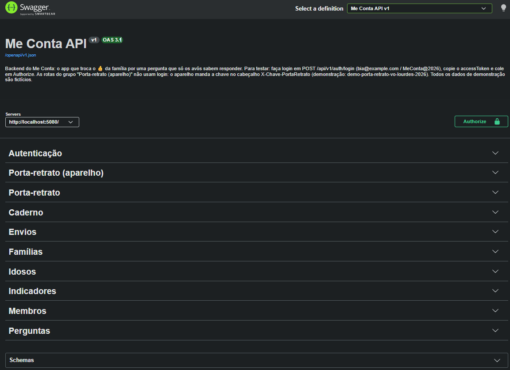

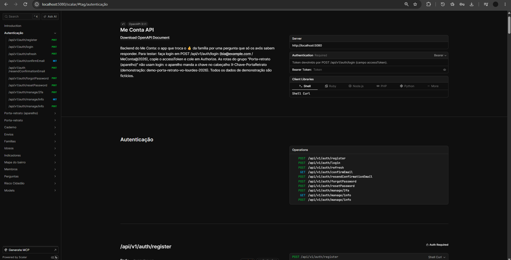

### Login e envio da pergunta pelo WhatsApp

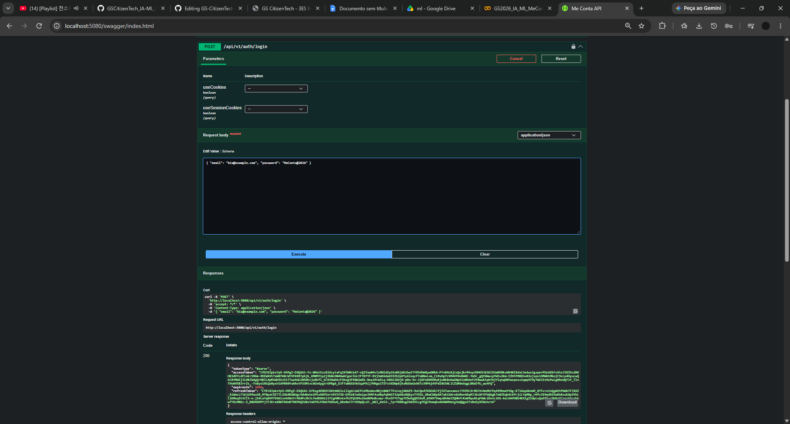

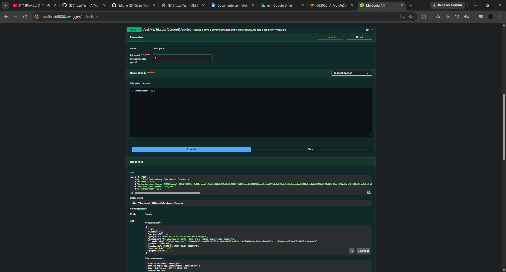

### Caderno da família

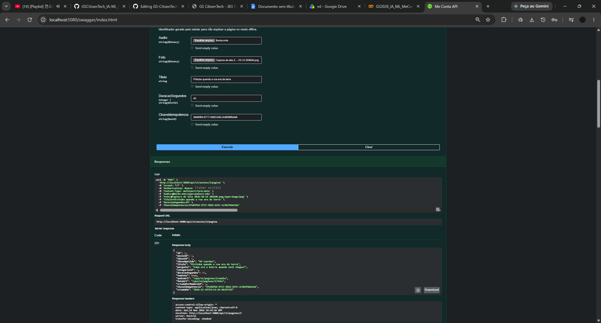

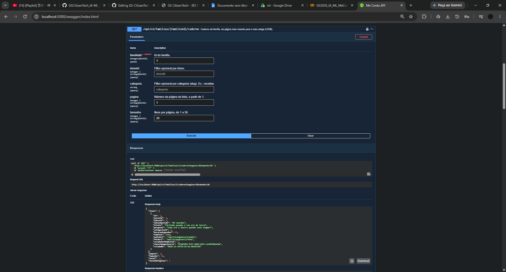

### Regras de negócio em ação

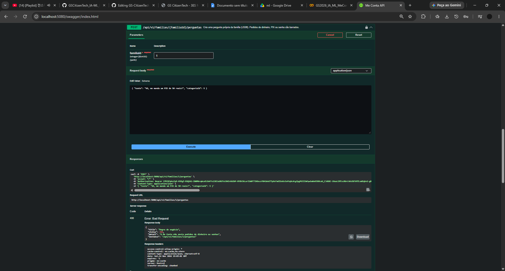

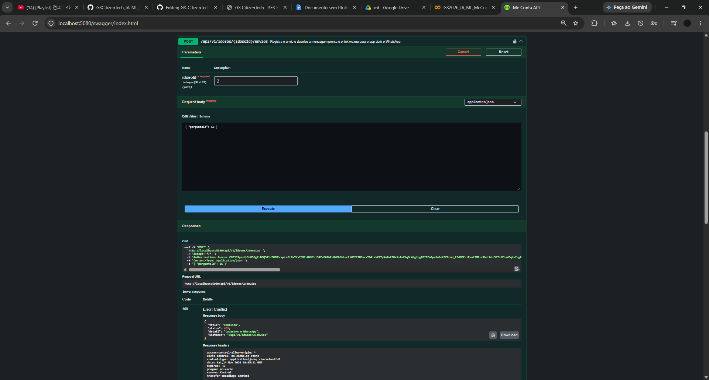

### Indicador de impacto

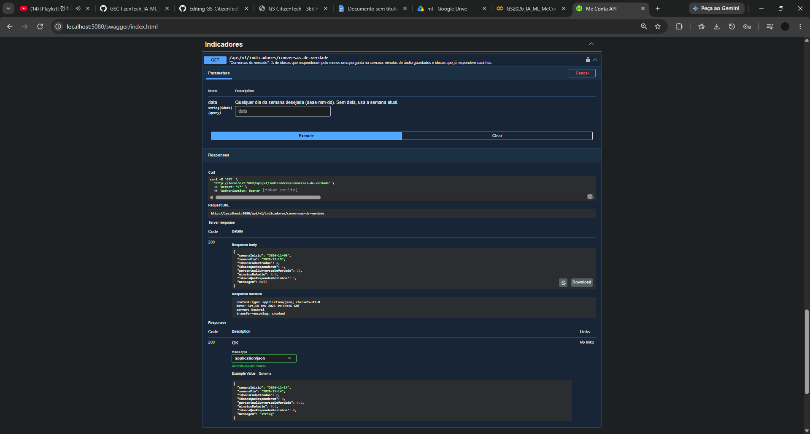

### Banco de dados, migrações e testes

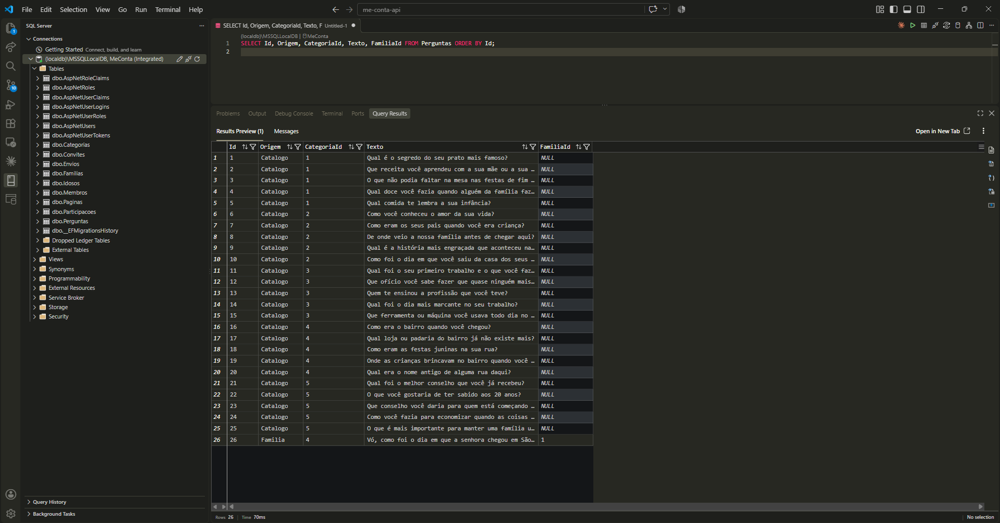

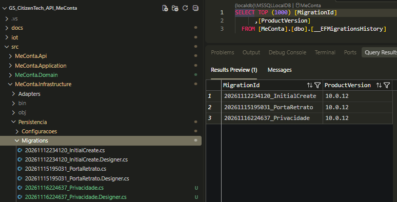

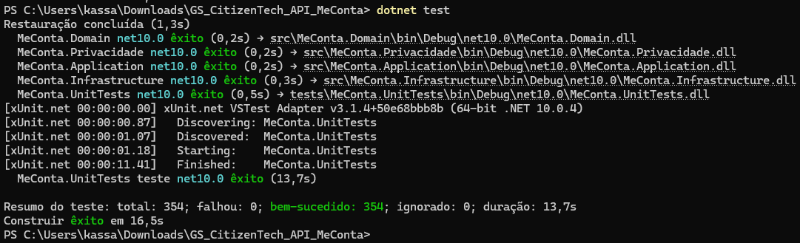

## Privacidade e segurança

- **Dados mínimos (LGPD, art. 6º, III):** o idoso é cadastrado só com nome, apelido e WhatsApp. Nenhuma tela pede CPF, endereço, data de nascimento ou dados de saúde.
- **Só a família vê a família:** toda rota de família, idoso, envio e caderno passa pelo `ControleDeAcesso` (403 para quem não é membro).
- **Proteção contra golpes:** o Me Conta não envolve dinheiro e bloqueia perguntas que pedem PIX, senha ou código de verificação.
- **Arquivos seguros:** o nome do arquivo enviado nunca vira caminho no servidor (Guid gerado pela API) e caminhos fora da pasta de armazenamento são recusados.
- **Erros sem vazamento:** erros inesperados devolvem uma mensagem genérica; o detalhe fica só no log.
- **Somente dados fictícios:** os dados de demonstração usam o domínio reservado `example.com` e um telefone inventado.

## Tecnologias

| Uso | Tecnologia |
|---|---|
| Linguagem e plataforma | C# 14, .NET 10 |
| Web API | ASP.NET Core (Controllers) |
| Banco de dados | SQL Server, Entity Framework Core 10 (migrações, Fluent API, LINQ) |
| Login | ASP.NET Core Identity (API endpoints, token Bearer) |
| Documentação | Microsoft.AspNetCore.OpenApi, Swagger UI, Scalar |
| Testes | xUnit |
| Monitoramento | Health checks (`/health`) |

## Próximos passos

- **Testes de integração** dos endpoints com `WebApplicationFactory`.
- **Hospedagem** em uma VM Linux, com monitoramento de CPU, memória e disco.
- **Mapa de memórias do bairro** (degrau 3), com consentimento registrado e filtro de dados pessoais antes de publicar.
- **Transcrição dos áudios**, para buscar no caderno por palavra.
- **Login por código no celular**, no lugar de e-mail e senha.
