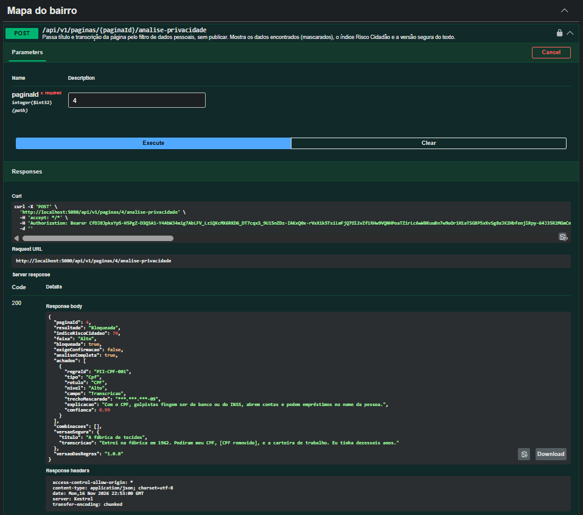
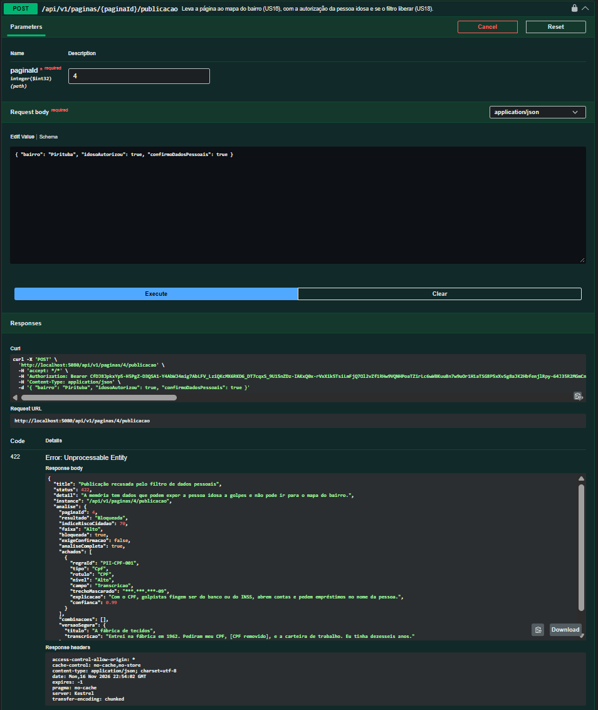
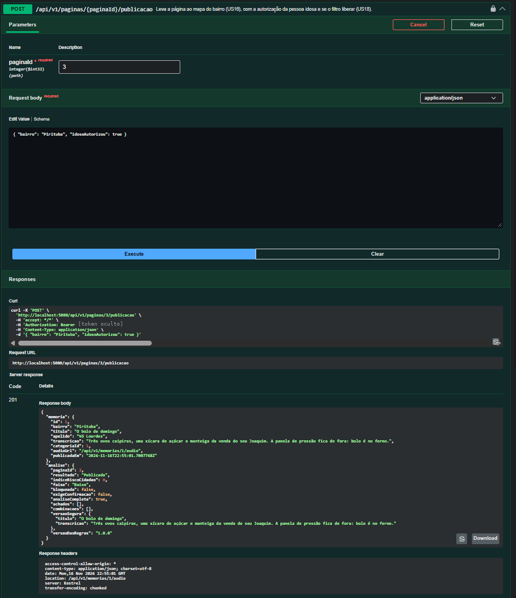
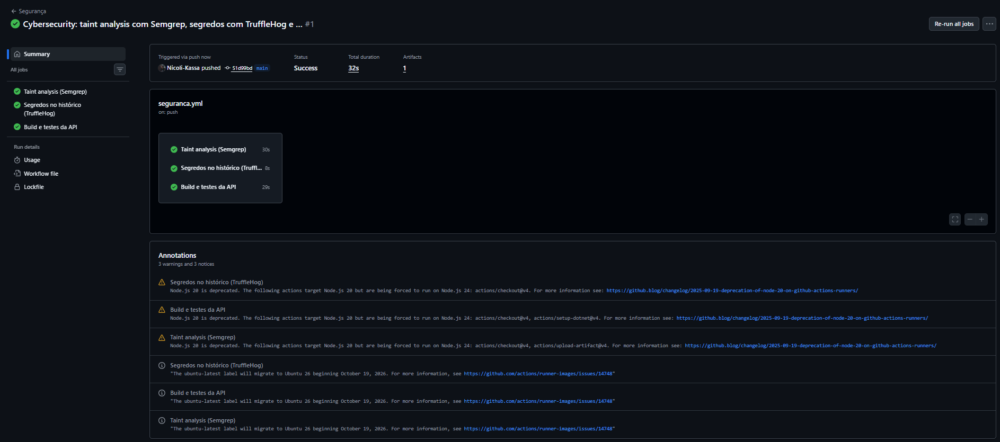
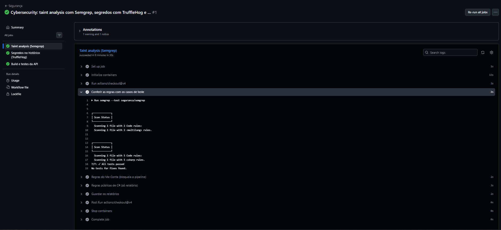
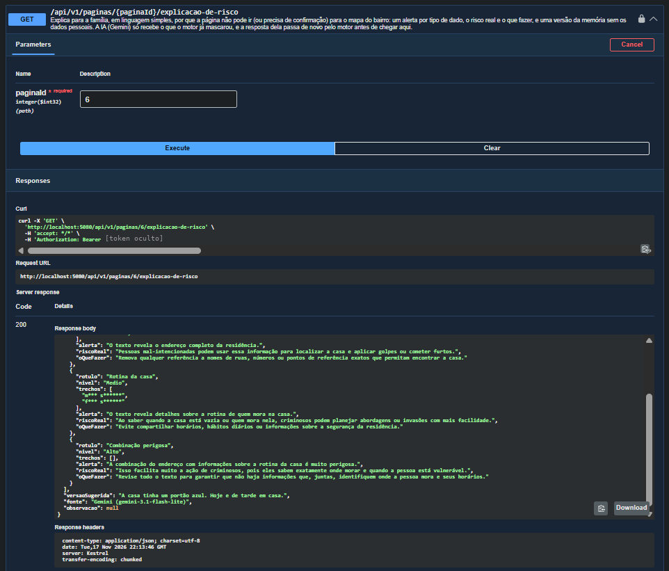
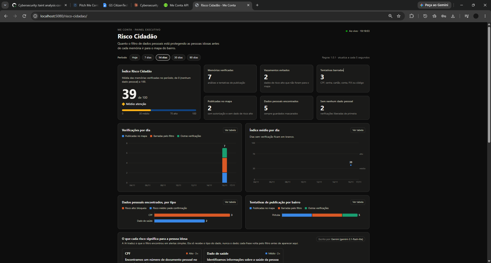
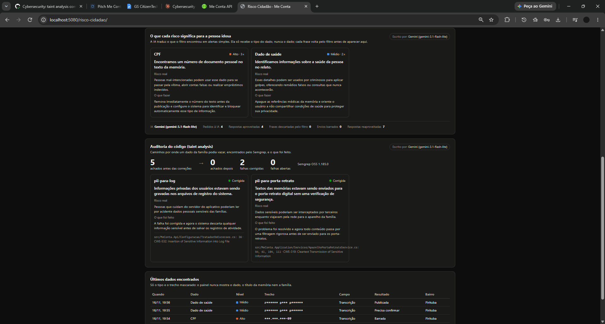
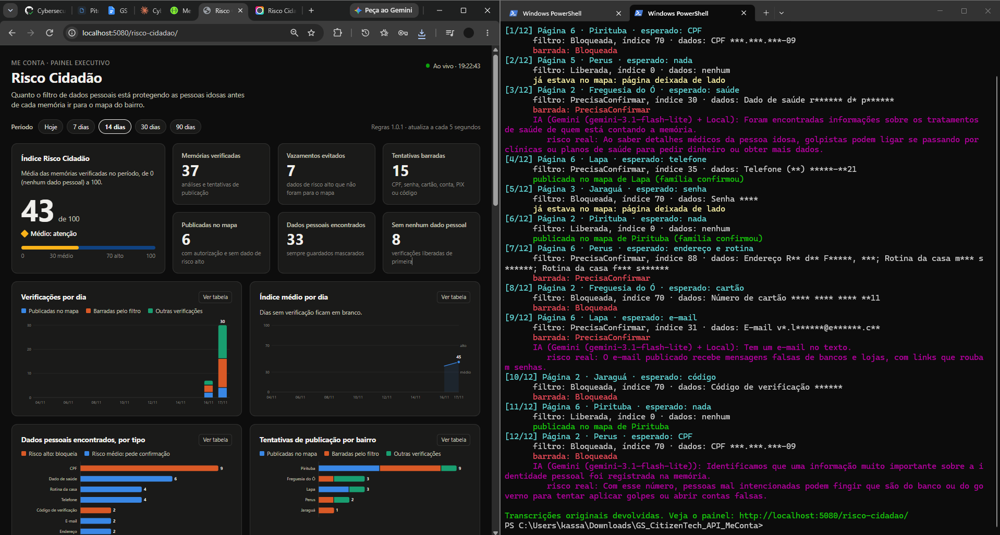

# Me Conta · Privacidade e Risco Cidadão (Cybersecurity)

### Integrantes

| Nome             | RM        | Turma |
| ---------------- | --------- | ----- |
| Nicoli Amy Kassa | RM 559104 | 3ESPW |

---

<br>

> Antes de uma memória sair da família e ir para o mapa do bairro, o Me Conta confere se ela não entrega a pessoa idosa a um golpista.

O **Me Conta** troca o 👍 da família por uma pergunta que só os avós sabem responder, e as respostas viram memórias em áudio. No degrau "Expandir", a família pode levar uma memória para o **mapa de memórias do bairro**, que qualquer morador ouve. É aí que mora o risco: uma avó contando a história da fábrica pode dizer o CPF que estava no crachá; contando dos chás, o remédio de pressão; contando da casa, que mora sozinha e a que horas fica sem ninguém. Esta parte do projeto protege a pessoa idosa nesse momento.

|                                   |                                                                                         |
| --------------------------------- | --------------------------------------------------------------------------------------- |
| 🎬 **Vídeo do painel com atividade** | [**Assistir no YouTube**](https://youtu.be/7wQlb6otvuU?si=8xcJbXF87NsftOyU)              |
| 📊 **Painel Risco Cidadão**       | `http://localhost:5080/risco-cidadao/` (com a API rodando)                              |
| 🧩 **Módulo de PII**              | [`src/MeConta.Privacidade`](../../src/MeConta.Privacidade) · [como funciona](motor-pii.md) |
| 🔎 **Taint analysis e auditoria** | [`seguranca/`](../../seguranca) · [como funciona](taint-analysis.md)                    |
| 🤖 **IA na remediação e painel**  | [como funciona](remediacao-ia.md)                                                       |
| 🧠 **API do Me Conta**            | [README da API](../../README.md)                                                        |

---

## Sumário

1. [Ficha da CitizenTech](#ficha-da-citizentech)
2. [O que foi pedido e onde está](#o-que-foi-pedido-e-onde-está)
3. [Como funciona](#como-funciona)
4. [Como executar](#como-executar)
5. [Evidências](#evidências)
6. [Privacidade, LGPD e limites](#privacidade-lgpd-e-limites)
7. [Arquivos](#arquivos)

---

## Ficha da CitizenTech

| Campo                       | Resposta |
| --------------------------- | -------- |
| **Nome da CitizenTech**     | Me Conta |
| **Cidade e bairro**         | São Paulo (SP). Bairro piloto: Pirituba, zona norte |
| **Cidadão beneficiado**     | Pessoas idosas, com mais de 60 anos, especialmente as que moram sozinhas, e seus netos e filhos. |
| **Problema em uma frase**   | Os avós guardam receitas, histórias da família e memórias do bairro que ninguém mais tem, mas, quando mandam um "bom dia" no grupo da família, recebem de volta um 👍 e nenhuma pergunta. |
| **A solução**               | O Me Conta é um aplicativo que troca o 👍 da família por uma pergunta que só os avós sabem responder. |
| **O papel da segurança**    | Nenhum dado que leve a um golpe (CPF, senha, cartão, conta, PIX, código) chega ao mapa do bairro; dados de risco médio (saúde, telefone, endereço, rotina da casa) só vão com a confirmação da família; o texto da família nunca chega cru a log, porta-retrato, IA ou mapa; e cada risco é explicado em linguagem simples. |
| **Indicador Risco Cidadão** | De 0 a 100, quanto uma memória expõe a pessoa idosa. No painel: a média do período, as tentativas barradas e os **vazamentos evitados** (dados de risco alto que estavam numa tentativa de publicação e não foram para o mapa). |
| **Link do repositório**     | [Me Conta API - GitHub](https://github.com/Nicoli-Kassa/GS_CitizenTech_API_MeConta) (pastas `src/MeConta.Privacidade`, `seguranca/` e `docs/cyber/`) |
| **ODS conectados**          | **ODS 10**, meta 10.2 (inclusão social de todos, independentemente da idade) · **ODS 11**, meta 11.4 (proteger o patrimônio cultural, aqui a memória do bairro) · **ODS 3**, meta 3.4 (bem-estar mental, pelo vínculo) |

## O que foi pedido e onde está

| Pedido | O que foi feito | Onde |
| --- | --- | --- |
| **Mapeamento de PII:** novas regras no motor de parsing (CPF, saúde, senhas) | Módulo `MeConta.Privacidade`, sem pacote externo: 17 regras em JSON (CPF com dígito verificador, RG, cartão com Luhn, agência e conta, PIX, senha, código de verificação, dois dicionários de saúde, telefone, e-mail, endereço, CEP, data de nascimento e rotina da casa), 3 combinações perigosas, normalização de texto falado ("um dois três ponto..."), índice Risco Cidadão e **falha fechada** (texto que não pôde ser conferido inteiro é bloqueado). Avaliado em 94 memórias simuladas (64 de desenvolvimento e 30 de validação): 100% de precisão e recall depois dos ajustes; a primeira rodada da validação (90% e 86%) e os ajustes estão registrados. | [`regras-pii.json`](../../src/MeConta.Privacidade/Regras/regras-pii.json), [`MotorPii.cs`](../../src/MeConta.Privacidade/Motor/MotorPii.cs), [`motor-pii.md`](motor-pii.md), testes em [`Privacidade/`](../../tests/MeConta.UnitTests/Privacidade) |
| **Taint analysis:** rastrear o fluxo e bloquear vazamentos em saídas inseguras | Três camadas: **tipos** (`TextoDoUsuario` só vira texto publicável pelo motor; o `ToString` não mostra o conteúdo), **5 regras Semgrep em modo taint** (fontes: título, transcrição, pergunta, apelido, bairro, caminho da URL; saídas: log, porta-retrato/MQTT, IA, mapa do bairro; higienizador: o motor) e **pipeline** no GitHub Actions que barra o push. A **auditoria do protótipo** achou 5 vazamentos reais (pergunta e apelido crus para o broker MQTT; caminho da URL no log de erro), corrigidos: 5 achados antes, 0 depois. TruffleHog no histórico: 0 segredos. | [`seguranca/semgrep/`](../../seguranca/semgrep), [`relatorios/`](../../seguranca/relatorios), [`seguranca.yml`](../../.github/workflows/seguranca.yml), [`taint-analysis.md`](taint-analysis.md) |
| **Tradução via IA:** LLM traduz falhas técnicas em alertas claros de risco real ao cidadão | O Gemini traduz cada achado do motor e cada falha do Semgrep em **alerta, risco real e o que fazer**, e reescreve a memória sem os dados. A IA é tratada como saída insegura: recebe só o tipo do dado e o trecho mascarado, o pedido passa pelo motor antes de sair e cada frase da resposta passa de novo antes de aparecer. Sem IA, valem os textos escritos pela equipe. | [`TradutorDeRisco.cs`](../../src/MeConta.Application/Servicos/TradutorDeRisco.cs), [`ExplicadorGemini.cs`](../../src/MeConta.Infrastructure/Ia/ExplicadorGemini.cs), [`remediacao-ia.md`](remediacao-ia.md) |
| **Dashboard executivo** com o indicador Risco Cidadão | Painel servido pela própria API, atualizado a cada 5 segundos: índice, vazamentos evitados, tentativas barradas, gráficos por dia, por tipo e por bairro (cada um com tabela), alertas traduzidos pela IA e auditoria do código traduzida. Script de atividade simulada para o vídeo. | [`wwwroot/risco-cidadao/`](../../src/MeConta.Api/wwwroot/risco-cidadao), [`RiscoCidadaoService.cs`](../../src/MeConta.Application/Servicos/RiscoCidadaoService.cs), [`simular-atividade.ps1`](../../seguranca/demo/simular-atividade.ps1) |

## Como funciona

```
 família escreve a memória (título, transcrição)        texto do usuário = contaminado
          │
          ▼
 ┌─────────────────────────────┐
 │ motor de PII                │  normaliza → aplica as regras → valida (CPF, Luhn, DDD)
 │ (MeConta.Privacidade)       │  → índice Risco Cidadão → texto com "[CPF removido]"
 └──────────────┬──────────────┘
                │ só achados mascarados e texto seguro
   ┌────────────┼──────────────┬──────────────────┬───────────────────┐
   ▼            ▼              ▼                  ▼                   ▼
 mapa do     log de        porta-retrato       IA (Gemini)         painel Risco
 bairro      auditoria     (broker MQTT)       + 2ª conferência     Cidadão
 (bloqueia   (só ids e     (pergunta           do motor            (só números
  alto, pede  trechos       mascarada)                              e trechos
  confirmação mascarados)                                           mascarados)
  no médio)

 Semgrep (taint) confere no código que nenhum caminho pula o motor · GitHub Actions barra o push
```

| Nível | Dados | O que acontece |
| --- | --- | --- |
| **Alto** | CPF, RG, cartão, agência e conta, PIX, senha, código de verificação | Bloqueia a publicação, mesmo com a confirmação da família (HTTP 422 com a análise) |
| **Médio** | Saúde, telefone, e-mail, endereço, CEP, data de nascimento, rotina da casa | Só publica se a família confirmar |
| — | Combinações (endereço + rotina, telefone + rotina, endereço + telefone) | Somam pontos ao índice |

## Como executar

Pré-requisitos e passo a passo completos no [README da API](../../README.md#como-executar). Em resumo, na pasta do projeto:

```powershell
# 1. Testes (354, inclusive os do motor, do taint e da IA)
dotnet test

# 2. (opcional) chave do Gemini, fora do repositório
dotnet user-secrets set "Gemini:ChaveApi" "<sua chave>" --project src\MeConta.Api

# 3. API com as páginas de demonstração do filtro
dotnet run --project src/MeConta.Api --launch-profile http -- --Banco:PaginasDoFiltroDePrivacidade=true

# 4. Em outro terminal: atividade simulada para o painel
powershell -ExecutionPolicy Bypass -File seguranca\demo\simular-atividade.ps1
```

- Painel: `http://localhost:5080/risco-cidadao/`.
- Passo a passo pelo Swagger: blocos **L** (passos 89 a 108, filtro e mapa do bairro) e **M** (109 a 117, IA e painel) do [roteiro de testes](../ROTEIRO_DE_TESTES.md).
- Taint analysis na sua máquina (com Semgrep instalado): `semgrep --test seguranca/semgrep` e `semgrep scan --config seguranca/semgrep --error`.
- Tabela de precisão e recall do motor: `dotnet run --project tools/MeConta.Privacidade.Avaliacao`.

## Evidências

### Motor de PII na API







### Taint analysis em ação





Relatórios da auditoria do protótipo: [antes das correções](../../seguranca/relatorios/antes-semgrep.txt) (5 achados) e [depois](../../seguranca/relatorios/depois-semgrep.txt) (0 achados); [teste das regras](../../seguranca/relatorios/teste-das-regras.txt); [TruffleHog](../../seguranca/relatorios/trufflehog.txt).

### IA na remediação



### Painel Risco Cidadão







Nos prints do Swagger, o token de login aparece como "[token oculto]".

## Privacidade, LGPD e limites

- **Consentimento (art. 7º, I):** nada vai para o mapa sem a caixa "a pessoa idosa autorizou"; ela pode tirar a memória do mapa na hora.
- **Dado sensível (art. 11):** saúde é sempre detectada e exige a confirmação da família.
- **Segurança (arts. 6º, VII, e 46):** o histórico e o log guardam só o tipo do dado e o trecho mascarado; o painel e a IA nunca recebem o dado.
- **Transferência para fora (art. 33):** no plano gratuito, o Google pode usar o que recebe. Por isso só sai o que o motor já mascarou; em produção, o caminho seria um plano com retenção desligada ou um modelo no próprio servidor.
- **Segredos:** chave do Gemini no user-secrets, nunca no repositório; regras do Semgrep e TruffleHog no pipeline conferem isso a cada push.
- **Somente dados fictícios:** o CPF 123.456.789-09 e o cartão 4111 1111 1111 1111 são números de teste; telefones e e-mails são inventados (`example.com`).
- **Limites conhecidos:** o motor não detecta nome completo de pessoas; o Semgrep gratuito rastreia dentro de cada método (entre métodos, quem garante são os tipos); a IA pode escrever um alerta impreciso, por isso o painel mostra sempre quem escreveu. Detalhes em cada documento da pasta.

## Arquivos

| Caminho | O que é |
| --- | --- |
| [`src/MeConta.Privacidade/`](../../src/MeConta.Privacidade) | Motor de PII: normalização, validadores, regras, índice e tipos do taint |
| [`src/MeConta.Application/Servicos/PrivacidadeService.cs`](../../src/MeConta.Application/Servicos/PrivacidadeService.cs) | Filtro antes do mapa do bairro, histórico e log de auditoria |
| [`src/MeConta.Application/Servicos/RiscoCidadaoService.cs`](../../src/MeConta.Application/Servicos/RiscoCidadaoService.cs) | Números do painel |
| [`src/MeConta.Application/Servicos/TradutorDeRisco.cs`](../../src/MeConta.Application/Servicos/TradutorDeRisco.cs) · [`RemediacaoService.cs`](../../src/MeConta.Application/Servicos/RemediacaoService.cs) · [`ExplicacoesLocais.cs`](../../src/MeConta.Application/Servicos/ExplicacoesLocais.cs) | IA na remediação, com as duas conferências e os textos de reserva |
| [`src/MeConta.Infrastructure/Ia/ExplicadorGemini.cs`](../../src/MeConta.Infrastructure/Ia/ExplicadorGemini.cs) | Chamada ao Gemini |
| [`src/MeConta.Api/wwwroot/risco-cidadao/`](../../src/MeConta.Api/wwwroot/risco-cidadao) | Painel executivo |
| [`seguranca/semgrep/`](../../seguranca/semgrep) | Regras de taint analysis e de segredos, com casos de teste |
| [`seguranca/relatorios/`](../../seguranca/relatorios) | Auditoria do protótipo, antes e depois |
| [`seguranca/demo/simular-atividade.ps1`](../../seguranca/demo/simular-atividade.ps1) | Atividade simulada para o vídeo |
| [`.github/workflows/seguranca.yml`](../../.github/workflows/seguranca.yml) · [`.pre-commit-config.yaml`](../../.pre-commit-config.yaml) | Pipeline de segurança e verificação antes do commit |
| [`tests/MeConta.UnitTests/Privacidade/`](../../tests/MeConta.UnitTests/Privacidade) · [`Remediacao/`](../../tests/MeConta.UnitTests/Remediacao) | Testes do motor, das memórias simuladas e da IA |
| [`tools/MeConta.Privacidade.Avaliacao/`](../../tools/MeConta.Privacidade.Avaliacao) | Tabela de precisão e recall do motor |
| [`motor-pii.md`](motor-pii.md) · [`taint-analysis.md`](taint-analysis.md) · [`remediacao-ia.md`](remediacao-ia.md) | Como cada parte funciona |
