# Me Conta · Porta-retrato (Physical Computing / IoT)

### Integrantes

| Nome             | RM        | Turma |
| ---------------- | --------- | ----- |
| Nicoli Amy Kassa | RM 559104 | 3ESPW |

---

<br>

> Uma caixinha na sala da avó que acende quando a família manda uma pergunta, e um botão grande para ela dizer "quero contar".

O porta-retrato é a parte física do **Me Conta**, o app que troca o 👍 da família por uma pergunta que só os avós sabem responder. Ele foi feito para o idoso que ainda não domina o celular: a pergunta chega numa moldura de LEDs com uma telinha, e a resposta começa com um único botão. O circuito usa os mesmos dados do app e da API: a pergunta que acende a moldura é a mesma que a neta mandou pelo app, e o aviso do botão aparece para a família.

|                                 |                                                                                                   |
| ------------------------------- | ------------------------------------------------------------------------------------------------- |
| 🔌 **Projeto no Wokwi**         | [wokwi.com/projects/480807903168932865](https://wokwi.com/projects/480807903168932865)            |
| 🎬 **Vídeo da integração**      | [**Assistir no YouTube**](https://youtu.be/INSERIR-LINK-DO-VIDEO-IOT)                             |
| 👥 **Integrantes**              | [`integrantes.txt`](integrantes.txt)                                                              |
| 🧠 **API do Me Conta**          | [README da API](../README.md) · rotas do aparelho em [Endpoints](../README.md#endpoints)          |
| 🗂️ **Onde cada entrega está**   | [docs/MATERIAS.md › Physical Computing (IoT)](../docs/MATERIAS.md#physical-computing-iot)         |

---

## Sumário

1. [Ficha da CitizenTech](#ficha-da-citizentech)
2. [Por que um porta-retrato](#por-que-um-porta-retrato)
3. [Como o circuito entra no Me Conta](#como-o-circuito-entra-no-me-conta)
4. [Arquitetura](#arquitetura)
5. [O circuito](#o-circuito)
6. [O que a caixinha faz](#o-que-a-caixinha-faz)
7. [Mensagens MQTT](#mensagens-mqtt)
8. [Ponte Node-RED e painel](#ponte-node-red-e-painel)
9. [Como executar](#como-executar)
10. [Testes](#testes)
11. [Evidências](#evidências)
12. [Privacidade e segurança](#privacidade-e-segurança)
13. [Arquivos desta pasta](#arquivos-desta-pasta)

---

## Ficha da CitizenTech

| Campo                     | Resposta                                                                                                                                                                                     |
| ------------------------- | -------------------------------------------------------------------------------------------------------------------------------------------------------------------------------------------- |
| **Nome da CitizenTech**   | Me Conta                                                                                                                                                                                     |
| **Cidade e bairro**       | São Paulo (SP). Bairro piloto: Pirituba, zona norte                                                                                                                                          |
| **Cidadão beneficiado**   | Pessoas idosas, com mais de 60 anos, especialmente as que moram sozinhas, e seus netos e filhos. O porta-retrato atende em especial **o idoso que ainda não usa bem o celular**.             |
| **Problema em uma frase** | Os avós guardam receitas, histórias da família e memórias do bairro que ninguém mais tem, mas, quando mandam um "bom dia" no grupo da família, recebem de volta um 👍 e nenhuma pergunta.     |
| **A solução**             | O Me Conta é um aplicativo que troca o 👍 da família por uma pergunta que só os avós sabem responder.                                                                                        |
| **O papel do circuito**   | Levar a pergunta da família para dentro da casa do idoso sem depender do celular: a moldura acende, a telinha mostra quem perguntou e o quê, e o botão "quero contar" avisa a família na hora. |
| **Link do repositório**   | [Me Conta API - GitHub](https://github.com/Nicoli-Kassa/GS_CitizenTech_API_MeConta) (pasta `iot/`)                                                                                           |
| **ODS conectados**        | **ODS 10**, meta 10.2 (inclusão social de todos, independentemente da idade) · **ODS 11**, meta 11.4 (memória do bairro) · **ODS 3**, meta 3.4 (bem-estar pelo vínculo)                      |

## Por que um porta-retrato

O Me Conta funciona em três degraus: **Conectar**, **Conversar** e **Expandir**. No degrau "Conversar", a neta escolhe uma pergunta no app e manda pelo WhatsApp, e a avó responde por áudio. Só que parte dos idosos ainda está fora disso: não tem WhatsApp, não ouve a notificação, ou tem dificuldade com a tela pequena.

O porta-retrato é a resposta do degrau **Conectar** (user story **US15**, Feature "Porta-retrato Me Conta"):

- **Chamar a atenção sem assustar:** a moldura acende em âmbar "respirando" e toca uma melodia curta. Não é um alarme.
- **Ler sem óculos de leitura:** a telinha mostra o nome de quem perguntou em letra grande e a pergunta com rolagem automática, com acentos.
- **Um botão só:** "quero contar". A avó não precisa digitar nada; a família recebe o aviso e liga para ouvir a história (ou ajuda a gravar o áudio, que vira página do caderno).
- **Respeitar a casa:** um sensor de luz deixa o brilho mais baixo e tira o som quando o ambiente está escuro (modo noite).
- **Avisar quando está fora do ar:** se o Wi-Fi cai, a moldura pisca em vermelho, a telinha diz "Sem Wi-Fi" e o aparelho tenta reconectar sozinho; um "quero contar" apertado sem rede é guardado e enviado quando a conexão volta.

## Como o circuito entra no Me Conta

Não é um projeto à parte. O porta-retrato é um **cliente da mesma API** que o app usa, com o mesmo banco e as mesmas regras:

1. A família pareia a caixinha à Vó Lourdes (`POST /api/v1/idosos/{idosoId}/porta-retrato`). A API devolve um **código** público (`k7m2q9xd`, usado nos tópicos MQTT) e uma **chave** secreta, guardada no banco só como hash SHA-256.
2. A Bia manda uma pergunta pelo app (`POST /api/v1/idosos/{id}/envios`, o mesmo envio que abre o WhatsApp).
3. A ponte Node-RED pergunta à API, a cada 5 segundos, o que a caixinha deve mostrar (`GET /api/v1/porta-retrato/estado`, com a chave no cabeçalho `X-Chave-PortaRetrato`) e publica a resposta no MQTT.
4. O ESP32 recebe, acende a moldura, toca a melodia e mostra "Bia perguntou: ..." na telinha.
5. A Vó Lourdes aperta **quero contar**. O ESP32 publica o aviso, a ponte chama `POST /api/v1/porta-retrato/quero-contar` e a API registra um `AvisoQueroContar` (sem duplicar se o botão for apertado várias vezes).
6. A família vê o aviso (`GET /api/v1/familias/{id}/avisos?somenteNaoVistos=true`) e marca como visto (`POST /api/v1/avisos/{id}/visto`). A pergunta sai da fila da caixinha e a moldura apaga, ou mostra a próxima pergunta, se houver.
7. Enquanto isso, a ponte informa à API se a caixinha está ligada (`PUT /api/v1/porta-retrato/conexao`), e a família vê "Conectada" ou "Desconectada".

As regras ficam na API, testadas com xUnit: [`PortaRetrato`](../src/MeConta.Domain/Entidades/PortaRetrato.cs), [`AvisoQueroContar`](../src/MeConta.Domain/Entidades/AvisoQueroContar.cs), [`FilaDoPortaRetrato`](../src/MeConta.Domain/Regras/FilaDoPortaRetrato.cs) e [`AparelhoPortaRetratoService`](../src/MeConta.Application/Servicos/AparelhoPortaRetratoService.cs).

## Arquitetura

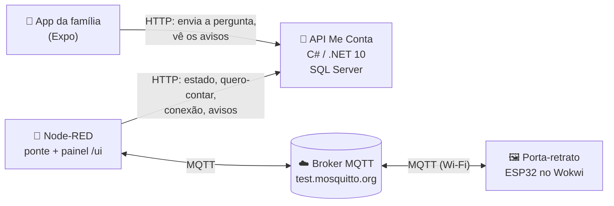

O ciclo completo, da pergunta ao aviso:

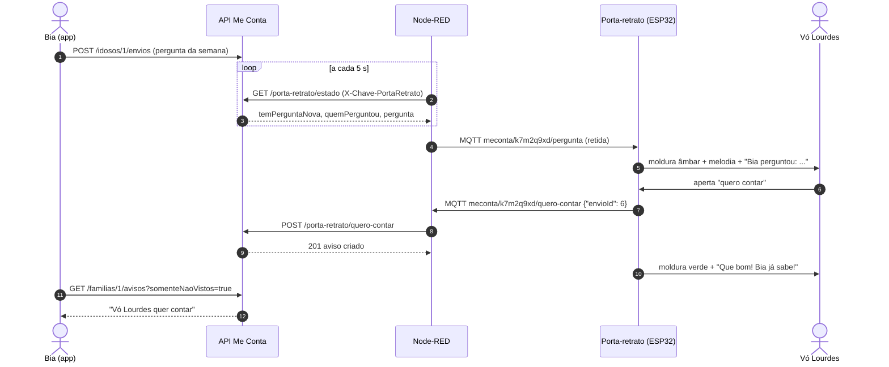

**Por que MQTT + Node-RED, e não o ESP32 chamando a API direto:** a simulação do Wokwi sai para a internet por um gateway público e não alcança `localhost`, onde a API roda durante o desenvolvimento. O broker público faz o meio do caminho, e o Node-RED, rodando na mesma máquina da API, traduz as mensagens em chamadas HTTP. Assim o ESP32 nunca guarda a chave da API: quem conversa com a API é a ponte.

## O circuito

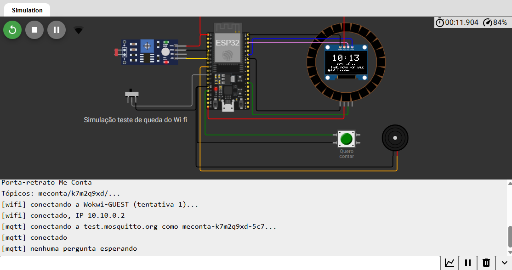

| Componente (Wokwi)                     | Id no `diagram.json` | Ligação no ESP32                 | Papel no Me Conta                                                         |
| -------------------------------------- | -------------------- | -------------------------------- | ------------------------------------------------------------------------- |
| ESP32 DevKit C v4                      | `esp`                | —                                | Cérebro da caixinha: Wi-Fi, MQTT, relógio (NTP) e lógica das telas        |
| Anel de LEDs RGB (NeoPixel, 24 LEDs)   | `moldura`            | DIN → GPIO 4 · VCC → 5V          | A **moldura** do porta-retrato: âmbar = pergunta, verde = obrigado, vermelho piscando = sem conexão |
| Tela OLED 128×64 (SSD1306, I²C)        | `telinha`            | SDA → GPIO 21 · SCL → GPIO 22 · 3V3 | Mostra quem perguntou, a pergunta (com rolagem e acentos), o relógio e os avisos |
| Botão verde "Quero contar"             | `botao`              | GPIO 13 (pull-up interno) · GND  | **Entrada** do idoso: avisa a família que ele quer responder              |
| Buzzer                                 | `buzzer`             | GPIO 25 · GND                    | Melodia curta quando chega pergunta e ao confirmar o aviso                |
| Sensor de luz (LDR)                    | `sensorLuz`          | AO → GPIO 34 · 3V3 · GND         | **Sensor** do ambiente: converte a leitura em lux, ajusta o brilho e liga o modo noite |
| Chave deslizante                       | `testeWifi`          | GPIO 27 · GND                    | Só para teste: simula a queda do Wi-Fi sem parar a simulação              |

O código está em [`wokwi/sketch.ino`](wokwi/sketch.ino), comentado em português, com as bibliotecas em [`wokwi/libraries.txt`](wokwi/libraries.txt): `PubSubClient` (MQTT), `ArduinoJson`, `Adafruit NeoPixel`, `Adafruit GFX Library`, `Adafruit SSD1306` e `Adafruit BusIO`.

Detalhes que fazem diferença para quem vai usar:

- **Brilho que acompanha a sala:** a leitura do LDR vira lux (fórmula do sensor) e o brilho vai de 150 (penumbra, 20 lux) a 255 (sala acesa, 300 lux ou mais) em escala logarítmica; abaixo de 10 lux entra o modo noite (brilho 60, sem som) e só sai acima de 20 lux, para não ficar piscando no limite.
- **Acentos na telinha:** o texto chega em UTF-8 e é convertido para a tabela da fonte do display, então "você", "Cláudia" e "avó" aparecem certos.
- **Nada trava:** animação, melodia, rolagem do texto, leitura do botão (com antirrepique) e reconexão rodam sem `delay()`, cada um no seu tempo.

## O que a caixinha faz

| Situação                  | Moldura (anel de LEDs)                    | Telinha                                                | Som                         |
| ------------------------- | ----------------------------------------- | ------------------------------------------------------ | --------------------------- |
| Ligando                   | Ponto azul girando                        | "Me Conta" e "conectando..."                           | —                           |
| Descanso (nada novo)      | Apagada                                   | Relógio, dia da semana, "Nada novo por aqui" e "Vó Lourdes" com um coração | —           |
| **Pergunta nova**         | Âmbar "respirando"                        | "Bia perguntou:" + pergunta com rolagem + "Aperte: quero contar" | Melodia de duas notas |
| Depois do **quero contar** | Verde, pisca duas vezes e apaga devagar  | "Que bom! Bia já sabe! Logo vão te ligar para ouvir a sua história." | Melodia de três notas |
| **Sem Wi-Fi / sem servidor** | Vermelho piscando (meio segundo)       | "Sem Wi-Fi", "Sem conexão agora." e "Tento de novo em 30s"; se o botão foi apertado, "Seu aviso está guardado" | — |
| **Modo noite** (sala escura) | Mesmas cores, brilho baixo             | Lua no lugar do coração                                | Sem som                     |

Se houver mais de uma pergunta esperando, a telinha mostra a mais recente e um "+1" (ou "+2"...) no canto. O monitor serial registra cada passo (`[wifi]`, `[mqtt]`, `[botao]`, `[luz]`, `[som]`), o que ajuda a acompanhar a demonstração.

## Mensagens MQTT

Broker `test.mosquitto.org:1883`. Todos os tópicos começam com `meconta/<código do aparelho>/`; no ambiente de demonstração, `meconta/k7m2q9xd/`.

| Tópico         | Quem publica → quem recebe | Retida | Conteúdo                                                                                                                                                          |
| -------------- | -------------------------- | ------ | ----------------------------------------------------------------------------------------------------------------------------------------------------------------- |
| `pergunta`     | Node-RED → ESP32           | Sim (QoS 1) | `{"temPerguntaNova":true,"apelido":"Vó Lourdes","perguntasEsperando":2,"envioId":6,"quemPerguntou":"Bia","pergunta":"Como você conheceu o amor da sua vida?"}` ou `{"temPerguntaNova":false,"apelido":"Vó Lourdes","perguntasEsperando":0}` |
| `quero-contar` | ESP32 → Node-RED           | Não    | `{"envioId":6}` (ou `{"envioId":null}` quando não há pergunta na tela)                                                                                            |
| `status`       | ESP32 → Node-RED           | Sim    | `online` ao conectar; `offline` como *last will*, enviado pelo broker quando a caixinha some (keepalive de 30 s)                                                  |
| `ambiente`     | ESP32 → Node-RED           | Não    | `{"lux":365.2,"modoNoite":false,"brilho":228}` a cada 10 s e na troca de modo                                                                                     |

A mensagem `pergunta` é **retida**: se a caixinha reiniciar ou reconectar, recebe na hora o que deve mostrar, sem esperar a próxima consulta à API. A ponte só publica quando o conteúdo muda.

## Ponte Node-RED e painel

O fluxo está em [`node-red/flows.json`](node-red/flows.json): uma aba, **"Ponte do porta-retrato"**, organizada em partes com comentários.

| Parte | O que faz                                                                                                                                       | Rota da API                                       |
| ----- | ----------------------------------------------------------------------------------------------------------------------------------------------- | ------------------------------------------------- |
| 1     | A cada 5 s, pergunta à API o que a caixinha deve mostrar e publica em `pergunta` (retida) só quando muda                                         | `GET /api/v1/porta-retrato/estado`                |
| 2     | Recebe o botão `quero-contar`, avisa a API e atualiza a caixinha e a lista de avisos na hora                                                    | `POST /api/v1/porta-retrato/quero-contar`         |
| 3     | Recebe `status` (online/offline) e, com a caixinha ligada, manda um sinal de vida a cada 30 s                                                   | `PUT /api/v1/porta-retrato/conexao`               |
| 4     | Recebe `ambiente` e mostra a luz no painel (medidor, gráfico dos últimos 10 min e modo noite)                                                   | —                                                 |
| 5     | A cada 5 s, lista os avisos que a família ainda não viu (entrando como a Bia); o botão **Visto** marca na API                                    | `GET /api/v1/familias/{id}/avisos` · `POST /api/v1/avisos/{id}/visto` |
| 6     | Botão **"Bia manda a pergunta da semana"**: faz pelo painel o mesmo envio que o app faz, para demonstrar o ciclo sem abrir o celular              | `GET /api/v1/idosos/{id}/pergunta-da-semana` · `POST /api/v1/idosos/{id}/envios` |
| —     | Sub-rotina "garantir login": entra como a Bia e guarda o token (usada pelas partes 5 e 6)                                                       | `POST /api/v1/auth/login`                         |

As configurações ficam nas **variáveis de ambiente da aba** (duplo clique na aba): `API_URL` (`http://localhost:5080`), `CHAVE_PORTA_RETRATO`, `IDOSO_ID`, `FAMILIA_ID`, `EMAIL_FAMILIA` e `SENHA_FAMILIA`. Os valores que vêm no arquivo são os **dados fictícios de demonstração** da API.

O painel (`/ui`, pacote `node-red-dashboard`) é a visão da família durante a demonstração:

| Grupo                  | O que mostra                                                                                     |
| ---------------------- | ------------------------------------------------------------------------------------------------ |
| **Na caixinha agora**  | Caixinha Conectada/Desconectada, o que está na telinha, o último "quero contar" e se a API está no ar |
| **Avisos para a família** | "Vó Lourdes quer contar", com a pergunta e a hora, e o botão Visto                           |
| **Luz do ambiente**    | Lux agora, gráfico dos últimos 10 minutos e modo noite ligado/desligado                          |
| **Família (simulação)** | Botão que manda a pergunta da semana e o resultado do envio                                     |

## Como executar

A ordem importa: **API → Node-RED → Wokwi**.

### 1. API

Siga o [Como executar](../README.md#como-executar) do README da API. Em resumo:

```powershell
dotnet run --project src/MeConta.Api --launch-profile http
```

Confira em http://localhost:5080/health. A API já cria o porta-retrato de demonstração da Vó Lourdes (código `k7m2q9xd`).

### 2. Node-RED

```powershell
npm install -g --unsafe-perm node-red
node-red
```

1. Abra http://127.0.0.1:1880.
2. Menu (☰) → **Gerenciar paleta** → **Instalar** → procure `node-red-dashboard` → **Instalar**.
3. Menu (☰) → **Importar** → selecione [`node-red/flows.json`](node-red/flows.json) → **Importar** → **Implementar**.
4. Abra o painel em http://127.0.0.1:1880/ui.

Os nós devem mostrar "conectado" e "login ok". Se aparecer `ECONNREFUSED`, a API não está no ar (ou troque `API_URL` por `http://127.0.0.1:5080`).

### 3. Porta-retrato no Wokwi

1. Abra **https://wokwi.com/projects/480807903168932865** e clique em ▶.
2. No monitor serial devem aparecer `[wifi] conectado`, `[mqtt] conectado` e, em seguida, o relógio na telinha. O painel passa a mostrar **Caixinha 🟢 Conectada**.

Para montar do zero: crie um projeto ESP32 **Arduino** em https://wokwi.com/projects/new/esp32 e substitua `sketch.ino`, `diagram.json` e `libraries.txt` pelos arquivos de [`wokwi/`](wokwi).

### 4. Demonstração

| Passo | Onde       | Ação                                                    | O que acontece                                                                |
| ----- | ---------- | ------------------------------------------------------- | ----------------------------------------------------------------------------- |
| 1     | Painel     | **Bia manda a pergunta da semana**                      | "Resultado: Enviada: ..."                                                     |
| 2     | Wokwi      | Esperar até 10 s                                        | Moldura âmbar, melodia, "Bia perguntou: ..." na telinha                       |
| 3     | Wokwi      | Apertar **Quero contar**                                | Moldura verde, "Que bom! Bia já sabe!"                                        |
| 4     | Painel     | Olhar "Avisos para a família"                           | "Vó Lourdes quer contar" com a pergunta e a hora; a telinha volta ao descanso |
| 5     | Wokwi      | Clicar no sensor de luz e baixar para menos de 10 lux    | Modo noite: brilho baixo, sem som; o painel mostra "Ligado"                   |
| 6     | Wokwi      | Mudar a chave "Simulação teste de queda do Wi-fi"        | Moldura vermelha piscando, "Sem Wi-Fi"; ao voltar a chave, reconecta sozinha  |
| 7     | Wokwi      | Parar a simulação                                       | Em até ~45 s o painel mostra "Caixinha 🔴 Desconectada" (*last will*)          |

## Testes

### Casos de teste da user story US15

| Caso     | Objetivo                                                                 | Resultado esperado                                                                                     | Resultado obtido (16/11/2026)                                                                                                               |
| -------- | ------------------------------------------------------------------------ | ------------------------------------------------------------------------------------------------------ | ------------------------------------------------------------------------------------------------------------------------------------------- |
| **CT36** | Porta-retrato acende com pergunta nova e o botão avisa a família        | Moldura acende em até 10 s; o botão avisa a família e apaga a moldura                                  | ✅ Passou. A pergunta 10, "Qual era o nome antigo de alguma rua daqui?", mandada pelo painel, acendeu a moldura; o "quero contar" enviou `{"envioId":10}`, a API registrou o aviso das 19:06 e a caixinha passou para a pergunta seguinte ([02](evidencias/02-caixinha-pergunta-vinda-da-api.png), [04](evidencias/04-caixinha-quero-contar.png), [11](evidencias/11-integracao-wokwi-e-painel.png)) |
| **CT37** | Porta-retrato sem Wi-Fi                                                  | A moldura pisca e o monitor serial mostra uma tentativa de reconexão a cada 30 s                       | ✅ Passou. Com a chave de teste, a moldura pisca em vermelho e a telinha mostra "Sem Wi-Fi" e "Tento de novo em 29s"; ao voltar a chave, o serial mostra a reconexão ao Wi-Fi e ao broker, e a pergunta que esperava volta à telinha ([06](evidencias/06-caixinha-queda-do-wifi.png), [07](evidencias/07-caixinha-reconexao.png)) |

### Testes automatizados (na API)

As regras do aparelho são cobertas pelos testes xUnit da API (`dotnet test`, 310 aprovados): [`PortaRetratoTests`](../tests/MeConta.UnitTests/Domain/PortaRetratoTests.cs), [`FilaDoPortaRetratoTests`](../tests/MeConta.UnitTests/Regras/FilaDoPortaRetratoTests.cs), [`AparelhoPortaRetratoServiceTests`](../tests/MeConta.UnitTests/Servicos/AparelhoPortaRetratoServiceTests.cs) e [`PortaRetratoServiceTests`](../tests/MeConta.UnitTests/Servicos/PortaRetratoServiceTests.cs). As chamadas 67 a 88 do [roteiro de testes](../docs/ROTEIRO_DE_TESTES.md) (Bloco K) testam as rotas do aparelho pelo Swagger, inclusive os casos de erro (chave inválida, pergunta de outro idoso, botão apertado várias vezes).

## Evidências

### A integração funcionando

**Wokwi e painel no mesmo momento:** a Vó Lourdes apertou "quero contar" na pergunta 10 (`[botao] quero contar (envio 10)`), o painel registrou o aviso das 19:06 e a caixinha já mostra a pergunta 11, que a Bia mandou em seguida pelo painel.

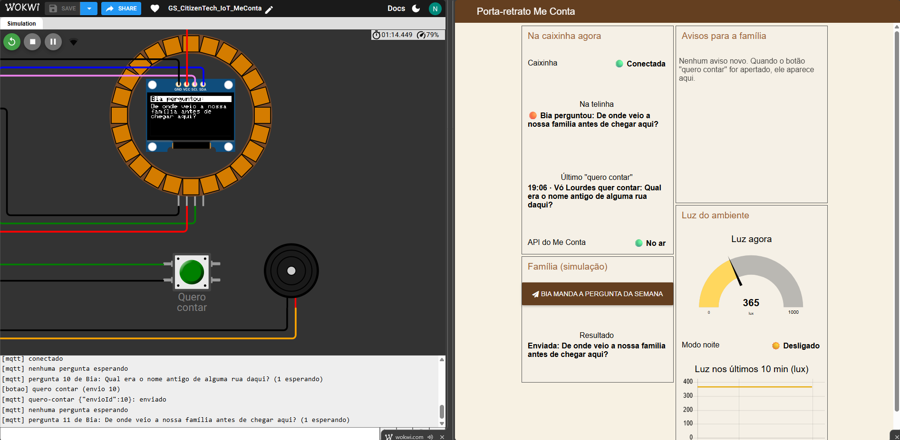

### A caixinha no Wokwi

**Pergunta nova:** a moldura acende em âmbar, o buzzer toca e a telinha mostra quem perguntou.

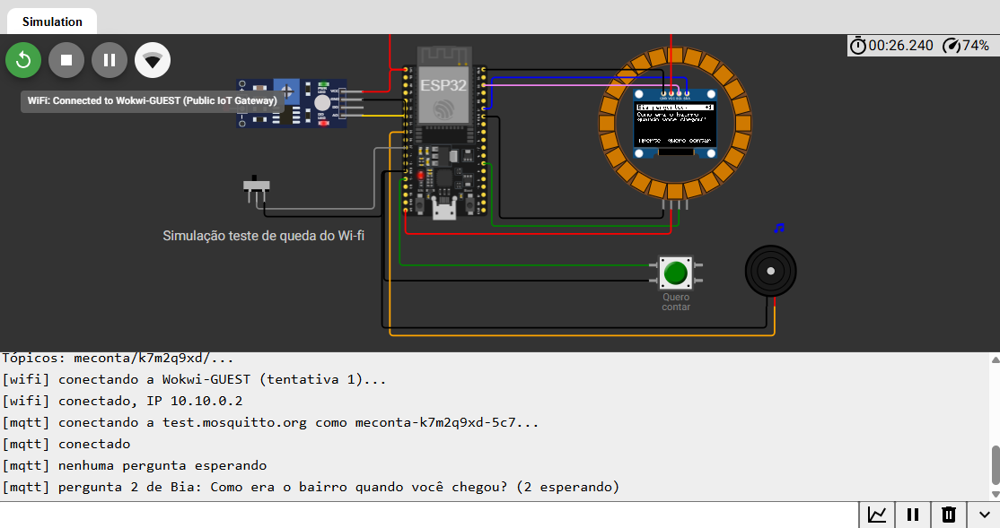

**Pergunta vinda da API:** a pergunta da semana mandada pela Bia chega pela ponte Node-RED; o serial mostra `pergunta 10 de Bia`.

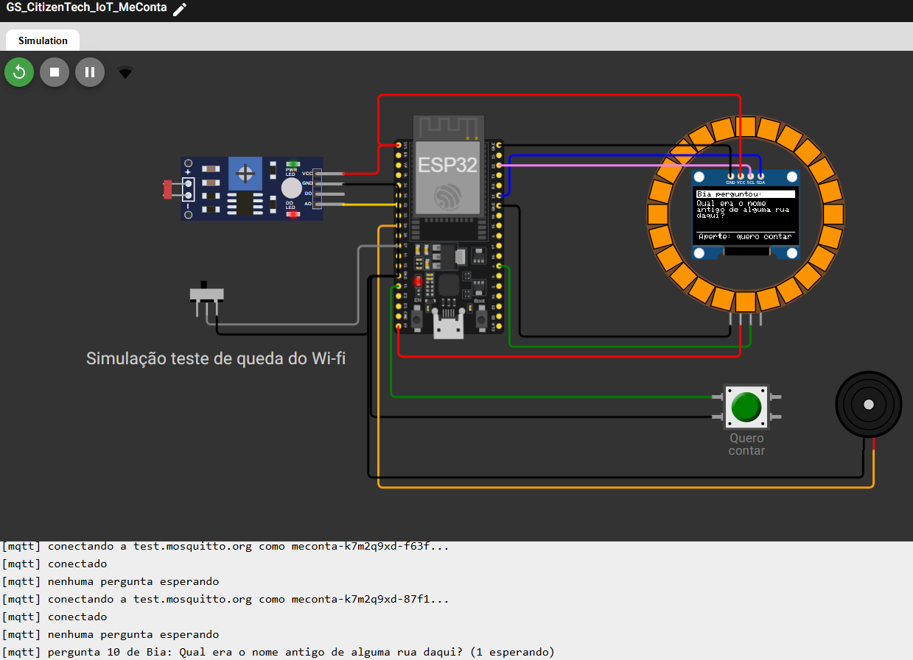

**Pergunta longa, com acentos:** a telinha rola o texto em partes.

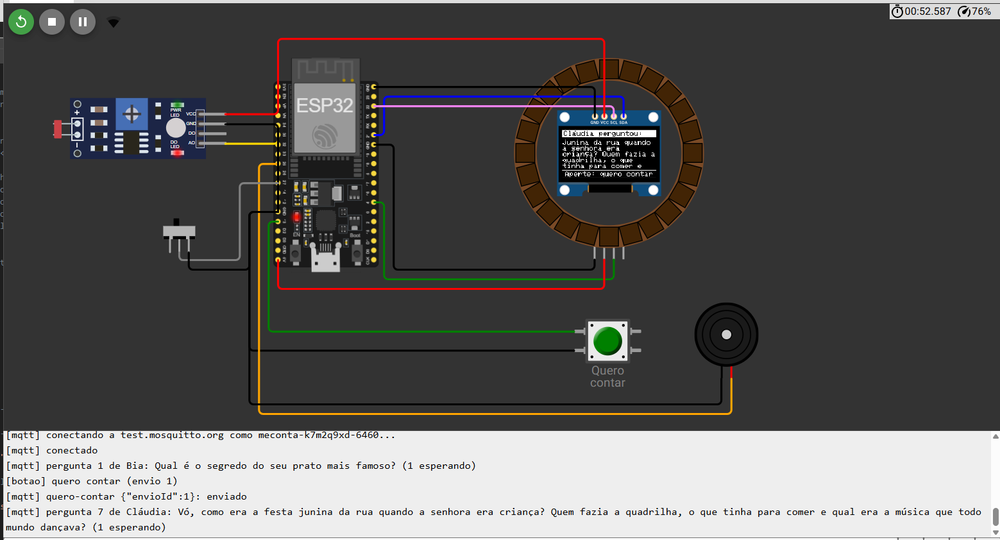

**Quero contar:** depois do botão, o aviso é enviado e a caixinha agradece.

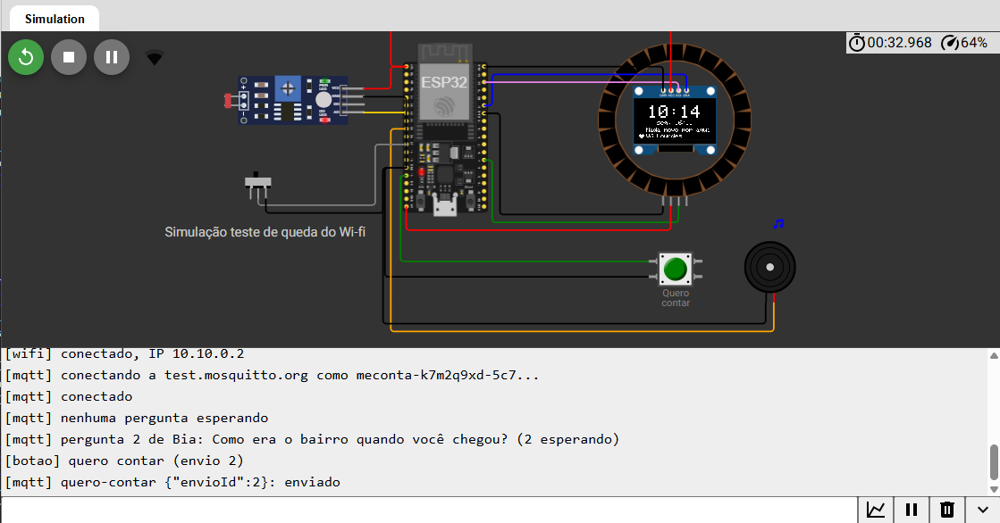

**Descanso:** sem pergunta esperando, a moldura apaga e a telinha mostra o relógio. O monitor serial mostra a conexão ao Wi-Fi e ao broker.


**Queda do Wi-Fi (CT37):** a moldura fica vermelha piscando, a telinha avisa e conta o tempo até a próxima tentativa.

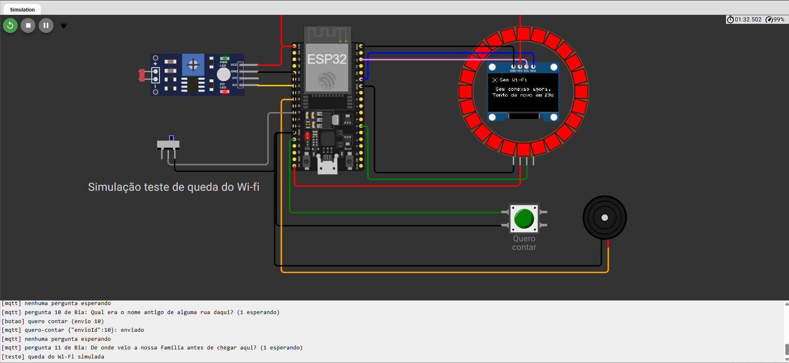

**Reconexão (CT37):** com a chave de volta, o aparelho reconecta ao Wi-Fi e ao broker sozinho e mostra de novo a pergunta que estava esperando.

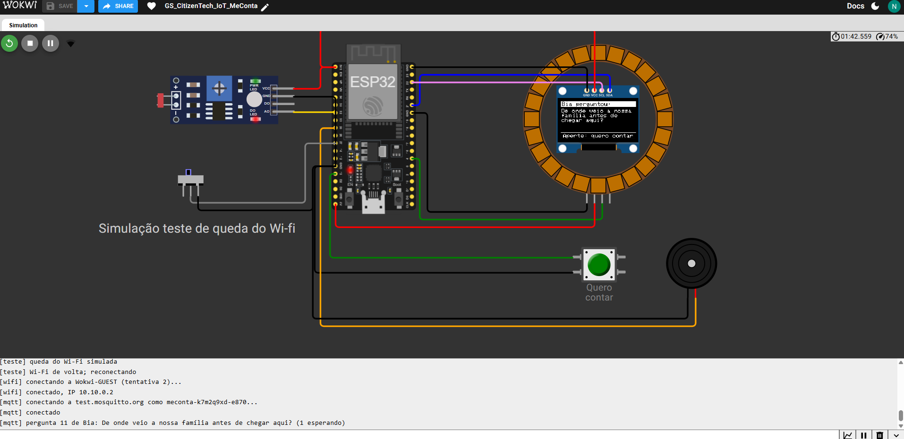

**Modo noite:** com a sala escura (8,1 lux), o brilho cai e o som é desligado.

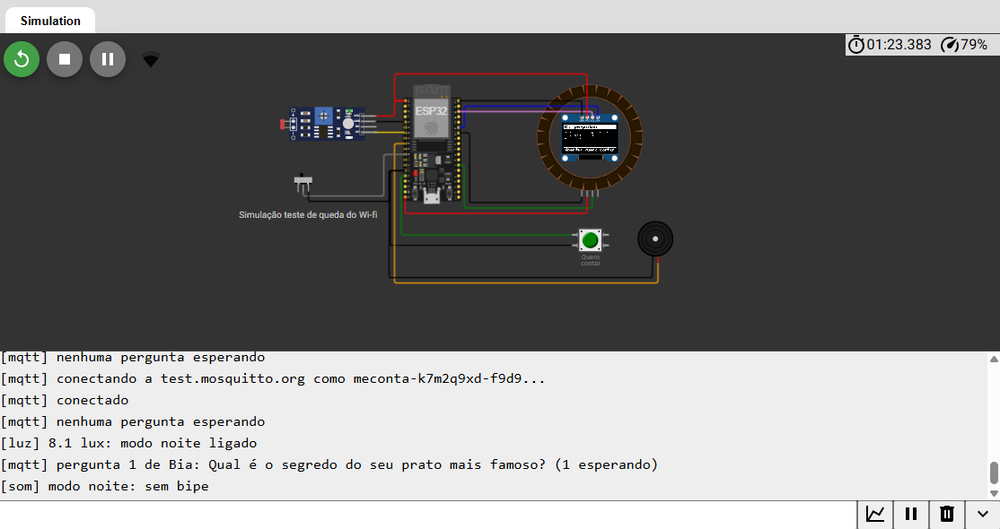

### O painel da família (Node-RED)

**Painel com a caixinha conectada:** a pergunta que está na telinha, os avisos "quero contar" com o botão Visto, a luz da sala e o envio da pergunta da semana.

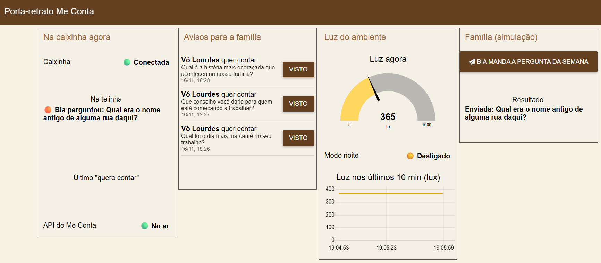

**Caixinha desligada:** com a simulação parada, o broker entrega o *last will* e o painel mostra a caixinha **Desconectada**.

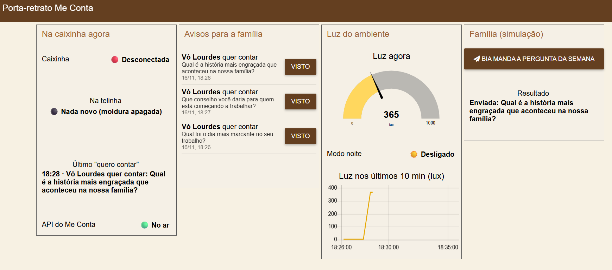

### O fluxo da ponte

**Partes 1 a 3:** estado da caixinha a cada 5 s, botão "quero contar" e conexão (online/offline e sinal de vida), todas conectadas à API.

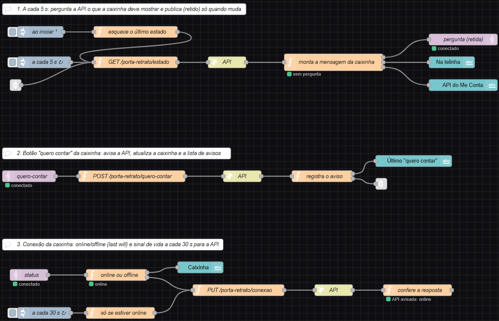

**Partes 4 a 6:** luz do ambiente, avisos para a família, simulação do envio da pergunta e a sub-rotina de login.

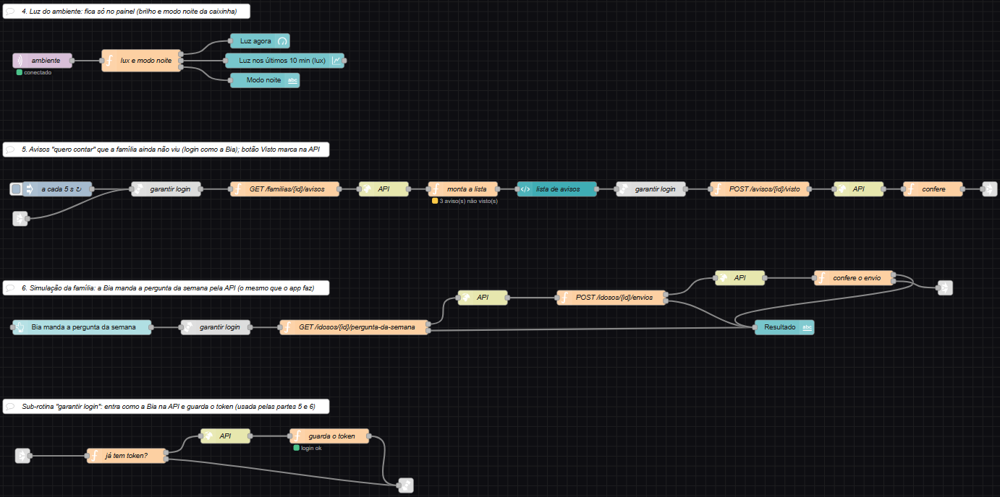

### As rotas do aparelho na API (Swagger)

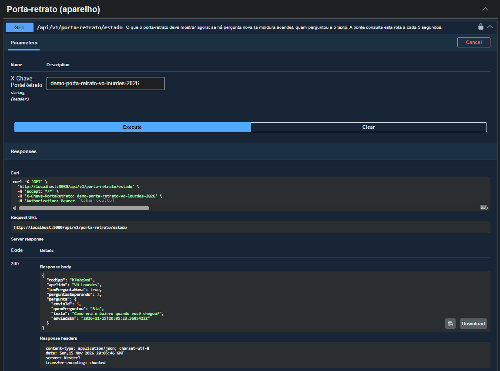

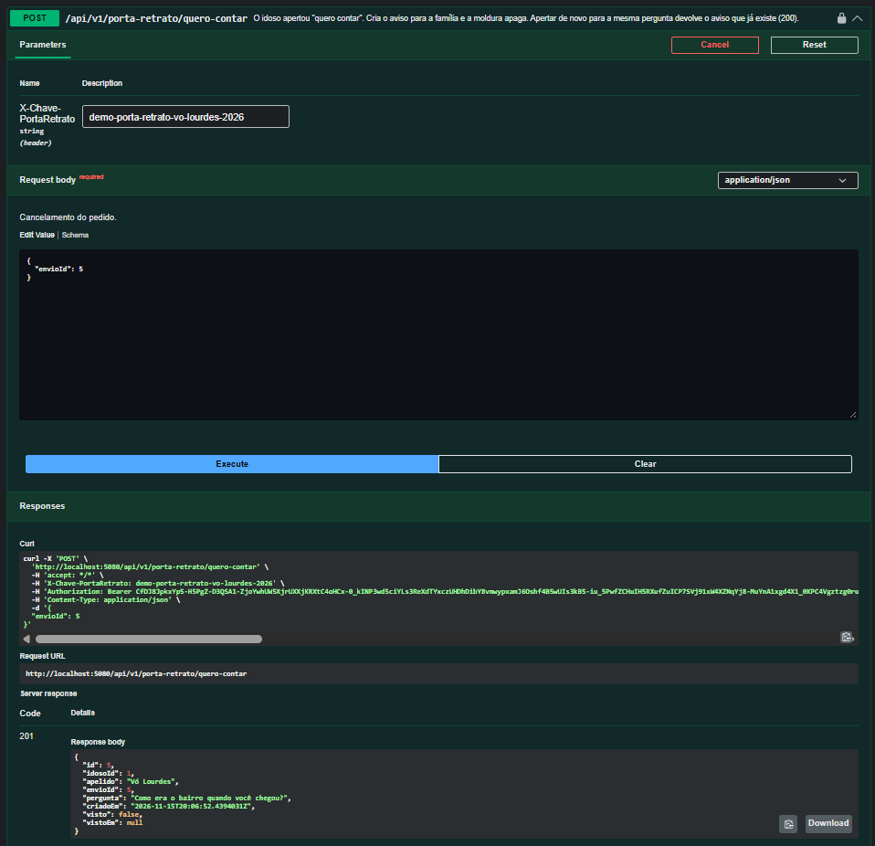

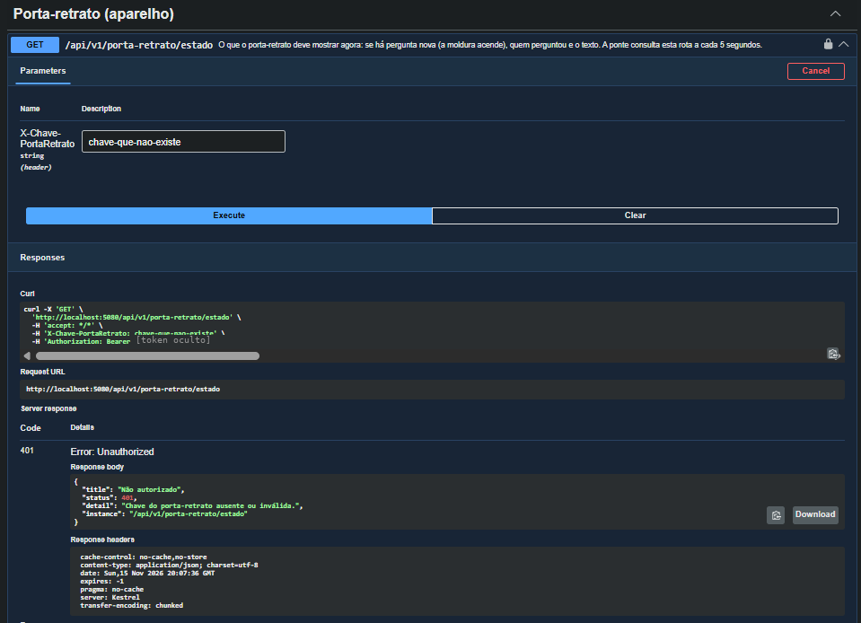

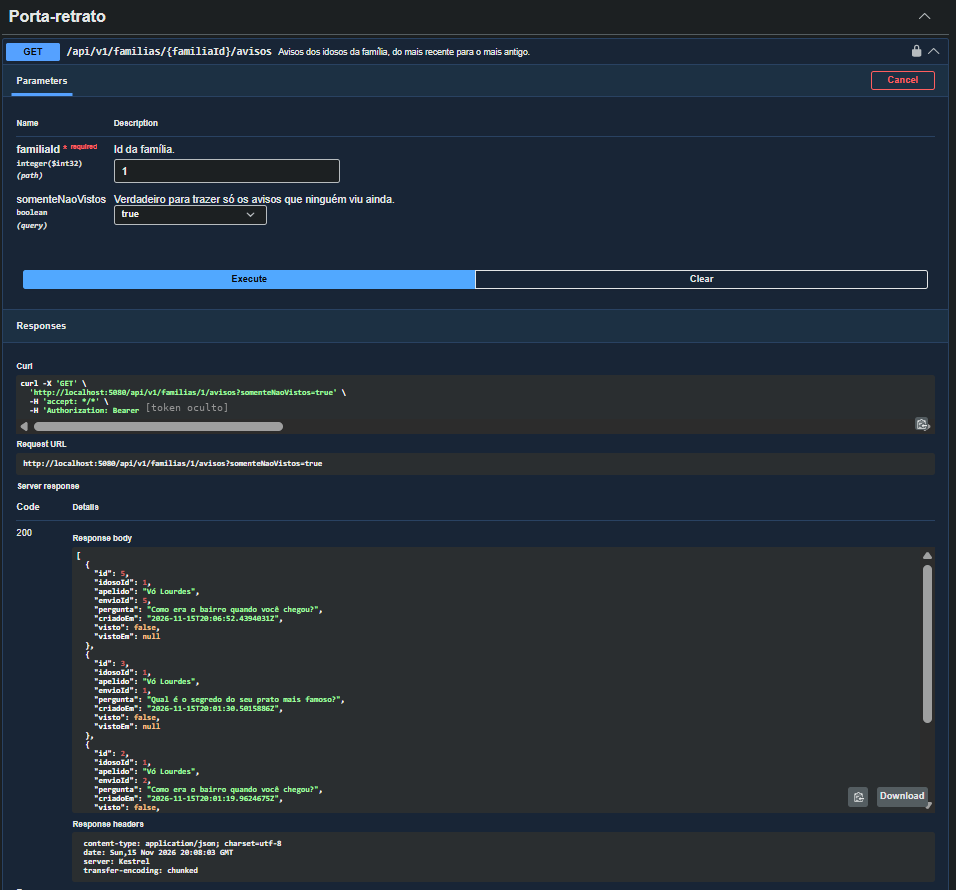

## Privacidade e segurança

- **O broker é público, então passa o mínimo:** apelido do idoso ("Vó Lourdes"), primeiro nome de quem perguntou e o texto da pergunta. Sem telefone, sobrenome, e-mail ou token.
- **O código nos tópicos não dá acesso a nada:** quem fala com a API é a ponte, com a **chave** do aparelho no cabeçalho `X-Chave-PortaRetrato`. A API guarda só o hash SHA-256 da chave e compara em tempo constante; um novo pareamento troca código e chave e invalida os antigos.
- **O aparelho só enxerga o próprio idoso:** um "quero contar" com a pergunta de outro idoso é recusado ("Essa pergunta não é deste porta-retrato").
- **A luz da sala fica em casa:** a leitura do sensor serve para o brilho e o modo noite e aparece só no painel da família; não vai para a API.
- **Dados de demonstração:** a chave, o e-mail e a senha do `flows.json` são os dados fictícios que a API cria no ambiente de desenvolvimento. Em produção, viriam de variáveis de ambiente, e o broker seria privado, com usuário, senha e TLS.

## Arquivos desta pasta

```
iot/
├── README.md               este documento
├── integrantes.txt         nome, RM e turma
├── wokwi/
│   ├── sketch.ino          firmware do ESP32 (Arduino)
│   ├── diagram.json        circuito: ESP32, anel de LEDs, telinha OLED, botão, buzzer, sensor de luz, chave de teste
│   └── libraries.txt       bibliotecas instaladas pelo Wokwi
├── node-red/
│   └── flows.json          ponte MQTT ↔ API e painel /ui
└── evidencias/             prints da caixinha, do painel e do fluxo
```
