# Me Conta · Servidor Linux (Operating Systems)

### Integrantes

| Nome             | RM        | Turma |
| ---------------- | --------- | ----- |
| Nicoli Amy Kassa | RM 559104 | 3ESPW |

|                         |                                                                       |
| ----------------------- | --------------------------------------------------------------------- |
| 🎬 **Vídeo (até 7 min)** | [**Assistir no YouTube**](https://youtu.be/RwSepaGcXhI)   |
| 🌐 **Servidor no ar**    | `http://meconta-nicoli.canadacentral.cloudapp.azure.com/swagger/`       |
| 📊 **Painel do servidor** | `http://meconta-nicoli.canadacentral.cloudapp.azure.com/servidor/`     |
| 🛡️ **Painel Risco Cidadão** | `http://meconta-nicoli.canadacentral.cloudapp.azure.com/risco-cidadao/` |
| ⬅️ **Repositório**       | [README principal da API](../README.md)                               |

---

## Ficha da CitizenTech

| Campo | Resposta |
| --- | --- |
| **Nome da CitizenTech** | Me Conta |
| **Cidade e bairro** | São Paulo (SP). Bairro piloto: Pirituba, zona norte |
| **Cidadão beneficiado** | Pessoas idosas, com mais de 60 anos, especialmente as que moram sozinhas, e seus netos e filhos. Pelo modo "Ensine sua avó", também os idosos que ainda não usam o celular. |
| **Problema em uma frase** | Os avós guardam receitas, histórias da família e memórias do bairro que ninguém mais tem, mas, quando mandam um "bom dia" no grupo da família, recebem de volta um 👍 e nenhuma pergunta. |
| **A solução** | O Me Conta é um aplicativo que troca o 👍 da família por uma pergunta que só os avós sabem responder. |
| **Como funciona** | O neto escolhe uma pergunta no app (receitas, história da família, ofícios, o bairro, conselhos). O app abre o WhatsApp com a mensagem pronta. O avô responde por áudio, do jeito que já sabe. A resposta vira uma memória, e vai para a página do caderno da família, com áudio, foto e título. O idoso volta a ser quem ensina e lembra. |
| **Link do repositório** | [Me Conta API - GitHub](https://github.com/Nicoli-Kassa/GS_CitizenTech_API_MeConta) (pasta `linux/`) |
| **Indicador de impacto** | Conversas de verdade por semana: % de idosos que respondem pelo menos uma pergunta da família por semana. Indicadores de apoio: minutos de áudio guardados no caderno de cada família e % de idosos que passam a responder sem ajuda depois do modo "Ensine sua avó". |
| **ODS conectados** | **ODS 10**, meta 10.2 (inclusão social de todos, independentemente da idade) · **ODS 11**, meta 11.4 (proteger o patrimônio cultural, aqui a memória do bairro) · **ODS 3**, meta 3.4 (bem-estar mental, pelo vínculo e não por cuidado de saúde) |

---

## A parte desta matéria no Me Conta

O caderno da família guarda a voz dos avós. Se o servidor cai, a neta não consegue guardar a resposta, e se o disco enche, uma memória pode se perder. Por isso a API do Me Conta roda num **servidor Linux montado do zero por script**, que se recupera sozinho de falhas, avisa antes de um recurso acabar e registra quem mexeu em quê.

```
           Internet (porta 80)
                  │
   ┌──────────────▼────────────────────────────────────────────────┐
   │ VM Ubuntu Server 24.04 · Azure Canada Central · meconta-srv   │
   │                                                               │
   │  ufw (só 22 com limite e 80)                                  │
   │    │                                                          │
   │  nginx :80 ── limite de requisições, log de auditoria         │
   │    ├── /            → API Me Conta (127.0.0.1:5000)           │
   │    │                  serviço meconta-api, usuário "meconta"  │
   │    │                  banco SQLite e áudios em /var/lib/meconta│
   │    └── /servidor/   → painel (status.json do monitor)         │
   │                                                               │
   │  meconta-monitor ── CPU, memória, disco e /health a cada 10 s │
   │                     alerta > 80% · reinicia a API travada     │
   │  systemd ── reinicia o que cair · watchdog do monitor         │
   │  auditd + journald + logs do Me Conta ── auditoria            │
   └───────────────────────────────────────────────────────────────┘
```

## Como cada item pedido é atendido

| Item | Onde está | Como funciona |
| --- | --- | --- |
| **Infraestrutura: VM, rede, DNS, IP e hostname** | [`etapas/rede.sh`](etapas/rede.sh), [`etapas/sistema.sh`](etapas/sistema.sh), [`etapas/seguranca.sh`](etapas/seguranca.sh) | VM Linux só com linha de comando no Azure. O script define o **hostname** (`meconta-srv`, protegido contra o cloud-init), o **/etc/hosts** com o domínio interno `meconta.interno`, o **IP privado** (`172.16.0.4`, lido da placa e conferido; o script também sabe gravá-lo fixo no netplan, com **rollback automático** em 120 s se a rede não responder) e o **DNS** no systemd-resolved (Cloudflare, Quad9 e o DNS do Azure). Confere o gateway, a resolução de nomes, o IP público (serviço de metadados do Azure) e o nome público `meconta-nicoli.canadacentral.cloudapp.azure.com`. Também: fuso de Brasília com NTP, swap de 2 GB, SSH só com chave e firewall `ufw`. |
| **Provisionamento da aplicação web** | [`etapas/aplicacao.sh`](etapas/aplicacao.sh), [`arquivos/meconta-api.service`](arquivos/meconta-api.service), [`arquivos/nginx-meconta.conf`](arquivos/nginx-meconta.conf) | Instala o .NET 10, baixa o código do GitHub, publica a API numa pasta por versão (`/opt/meconta/versoes/<data>-<commit>`) e troca o link `/opt/meconta/app` de uma vez. Se a versão nova não responder no `/health` em 90 s, **volta para a anterior**. A API roda como serviço systemd com usuário próprio sem login, sistema de arquivos somente leitura e limite de memória; o banco é SQLite. O nginx publica tudo na porta 80, com limite de tentativas de login. |
| **Monitoramento de CPU, disco e memória com alertas** | [`monitor/meconta-monitor.sh`](monitor/meconta-monitor.sh), [`painel/index.html`](painel/index.html) | A cada 10 s lê `/proc/stat`, `/proc/meminfo` e `df`. Acima de 80% por 3 leituras seguidas: **ALERTA** no `alertas.log`, no journal, na tela de quem estiver conectado por SSH (`wall`) e, se configurado, no celular (webhook). Quando volta: **NORMAL**. O alerta de CPU e de memória já diz qual processo mais consome. Painel web em `/servidor/`. |
| **Monitoramento como serviço tolerante a falhas** | [`arquivos/meconta-monitor.service`](arquivos/meconta-monitor.service) | Serviço systemd `Type=notify` com **watchdog** de 60 s (se o monitor travar, o systemd mata e reinicia), `Restart=always`, nunca desiste de reiniciar e é o último processo que o kernel mata se faltar memória. Além disso, **cuida da API**: se o `/health` falhar 3 vezes seguidas (processo vivo mas travado, que o systemd não percebe), reinicia a API. |
| **Logs de auditoria** | [`etapas/auditoria.sh`](etapas/auditoria.sh), [`arquivos/auditd-meconta.rules`](arquivos/auditd-meconta.rules), [`ferramentas/auditoria.sh`](ferramentas/auditoria.sh) | **auditd** registra mudanças em contas, sudo, SSH, rede, firewall, configuração e segredos do Me Conta, publicações, nginx, quem usou `systemctl` e **todo comando executado por uma pessoa logada**. Também: log de cada ação do provisionamento (data, usuário, etapa), log de acesso do nginx (IP, método, caminho, status, tempo), journal persistente e rotação diária com 14 dias. O relatório junta tudo numa tela. |
| **Teste de falha** | [`ferramentas/teste-de-falha.sh`](ferramentas/teste-de-falha.sh) | Derruba a API e o monitor (`kill -9`), congela a API e o monitor (`SIGSTOP`), põe a CPU em 100%, ocupa a memória e enche o disco, e confere a recuperação de cada um. Depois de um `sudo reboot`, `teste-de-falha.sh verificar` confere se tudo voltou sozinho. |
| **Segredos** | [`ferramentas/guardar-segredo.sh`](ferramentas/guardar-segredo.sh) | A chave do Gemini (usada pelo filtro de dados pessoais) fica **cifrada** com `systemd-creds`, nunca em variável de ambiente nem em arquivo de configuração. O systemd decifra só na hora de subir a API e entrega numa pasta em memória que só o serviço vê. |

## Estrutura da pasta

```
linux/
├── provisionar.sh            # script principal: roda as 6 etapas em ordem
├── meconta.conf              # tudo o que é configurável (nomes, IP, DNS, limites, repositório)
├── etapas/
│   ├── comum.sh              # funções de log e instalação usadas por todas as etapas
│   ├── sistema.sh            # 1. fuso, pacotes, swap
│   ├── rede.sh               # 2. hostname, /etc/hosts, IP fixo, DNS
│   ├── seguranca.sh          # 3. usuário do serviço, SSH, firewall
│   ├── aplicacao.sh          # 4. .NET, build, serviço da API, nginx
│   ├── monitoramento.sh      # 5. serviço meconta-monitor
│   └── auditoria.sh          # 6. auditd, journal persistente, rotação de logs
├── arquivos/                 # modelos instalados no sistema (units systemd, nginx, regras do auditd)
├── monitor/meconta-monitor.sh
├── painel/index.html         # painel web do servidor (/servidor/)
├── ferramentas/
│   ├── status.sh             # resumo do servidor numa tela
│   ├── auditoria.sh          # relatório de auditoria (quem fez o quê, quando)
│   ├── teste-de-falha.sh     # provoca falhas e confere a recuperação
│   └── guardar-segredo.sh    # guarda um segredo cifrado para a API
└── evidencias/               # prints
```

## Como executar

### 1. Criar a VM (portal do Azure)

1. **Máquinas virtuais > Criar**: Ubuntu Server 24.04 LTS (x64), série B, região **Canada Central** (a permitida na assinatura de estudante), autenticação por **chave SSH**, portas de entrada **22** e **80**.
2. No **IP público > Configuração**, preencher o **rótulo do nome DNS** (`meconta-nicoli`).
3. O IP privado fica como o Azure entregou (`172.16.0.4`). Para fixá-lo também dentro da VM, deixe-o **Estático** na NIC, preencha `IP_ESTATICO="sim"` e `IP_PRIVADO_FIXADO_NO_AZURE` no `meconta.conf` e rode `sudo bash provisionar.sh rede`.

### 2. Provisionar

```bash
ssh -i meconta-vm_key.pem nicoli@<IP_PUBLICO>

git clone https://github.com/Nicoli-Kassa/GS_CitizenTech_API_MeConta.git
cd GS_CitizenTech_API_MeConta/linux

nano meconta.conf                  # confira NOME_PUBLICO (rótulo DNS + região)
sudo bash provisionar.sh 2>&1 | tee ~/provisionamento.txt   # todas as etapas (144 s no servidor do Me Conta)
sudo bash ferramentas/status.sh    # resumo do servidor
```

Abrir `http://<NOME_PUBLICO>/swagger/` e `http://<NOME_PUBLICO>/servidor/`. Com os dados de demonstração ligados, o login é `bia@example.com` / `MeConta@2026` (dados fictícios).

O script pode ser rodado de novo sem problema: cada etapa só muda o que ainda não está certo. Para **atualizar a API** depois de um push: `sudo bash provisionar.sh aplicacao`. Se a versão nova mudar as tabelas do banco, apague o banco de demonstração antes (`sudo systemctl stop meconta-api && sudo rm /var/lib/meconta/dados/meconta.db*`): no servidor o SQLite é criado a partir do modelo na primeira subida, com os dados fictícios.

### 3. Comandos úteis

| Para quê | Comando |
| --- | --- |
| Estado dos serviços | `systemctl status meconta-api meconta-monitor nginx` |
| Logs da API ao vivo | `journalctl -u meconta-api -f` |
| Alertas ao vivo | `sudo tail -f /var/log/meconta/alertas.log` |
| Acessos ao vivo | `sudo tail -f /var/log/nginx/meconta-acesso.log` |
| Relatório de auditoria | `sudo bash ferramentas/auditoria.sh` (últimas 24 h) |
| Eventos de uma chave do auditd | `sudo ausearch -k meconta-config -i` |
| Mudar os limites sem parar o monitor | editar `/etc/meconta/monitor.conf` e `sudo systemctl reload meconta-monitor` |
| Teste de falha | `sudo bash ferramentas/teste-de-falha.sh` (ou um teste: `cpu`, `disco`, `api`...) |
| Guardar a chave do Gemini | `sudo bash ferramentas/guardar-segredo.sh Gemini__ChaveApi` |

## Teste de falha

| Teste | O que provoca | O que se espera |
| --- | --- | --- |
| `api` | `kill -9` na API | o systemd sobe a API de novo em poucos segundos |
| `api-travada` | `SIGSTOP` na API (vivo, mas não responde) | o monitor vê o `/health` falhar 3 vezes e reinicia a API |
| `monitor` | `kill -9` no monitor | o systemd sobe o monitor de novo em ~5 s |
| `monitor-travado` | `SIGSTOP` no monitor | o watchdog (60 s) mata e reinicia o monitor |
| `cpu` | CPU em 100% por 70 s (`stress-ng`) | ALERTA de CPU (com o processo culpado) e NORMAL depois |
| `memoria` | memória ~10 pontos acima do limite por 70 s | ALERTA de memória e NORMAL depois |
| `disco` | arquivo de teste que leva o disco a ~85% | ALERTA de disco e NORMAL quando o arquivo é apagado |
| `verificar` | (depois de `sudo reboot`) | API, monitor, nginx e auditd ativos e habilitados no boot |

O resultado aparece na tela e fica em `/var/log/meconta/teste-de-falha.log`.

## Evidências

Resultados no servidor (19/11/2026): provisionamento completo em **144 s**; teste de falha com **6 de 6 testes aprovados**.

| Teste | Resultado no servidor |
| --- | --- |
| `api` (kill -9) | systemd reiniciou a API; `/health` de volta em **6 s** |
| `api-travada` (SIGSTOP) | o monitor viu o `/health` falhar 3 vezes e reiniciou a API; de volta em **34 s** |
| `monitor` (kill -9) | systemd reiniciou o monitor em **6 s** |
| `cpu` | ALERTA com CPU em **96%** (maior consumo: `stress-ng-cpu`, 97,9%) e NORMAL quando a carga acabou |
| `disco` | ALERTA com disco em **86%** e NORMAL (22%) depois de apagar o arquivo de teste |
| `verificar` (depois do reboot) | API, monitor, nginx e auditd ativos e habilitados; `/health` responde |

**01. Provisionamento completo** (fim da saída do `provisionar.sh`)

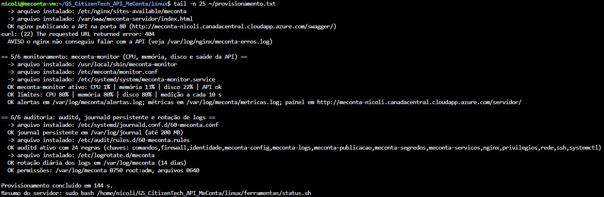

**02. Rede:** hostname, IP, rotas, DNS e `/etc/hosts` com o domínio interno

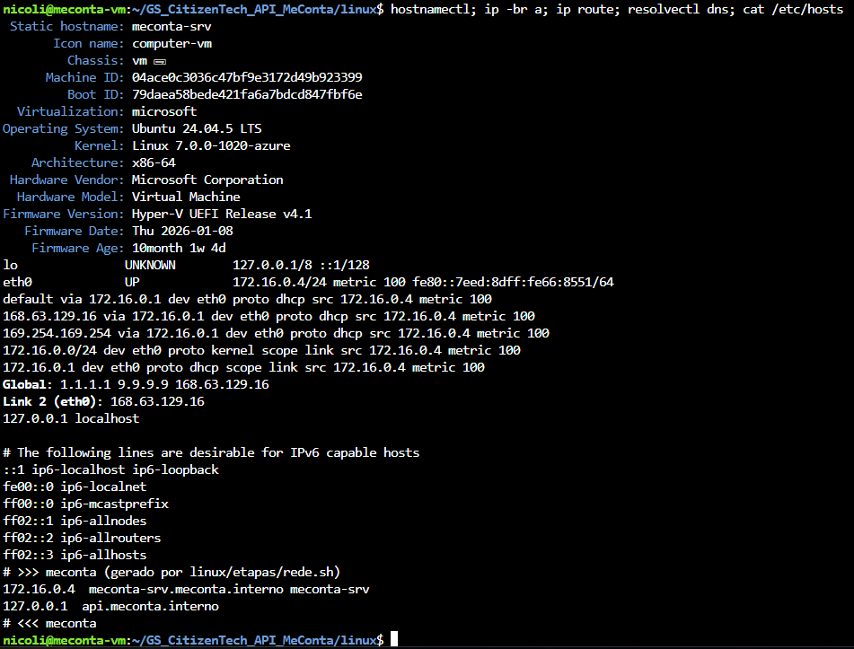

**03. Firewall:** entrada bloqueada, exceto SSH com limite e HTTP

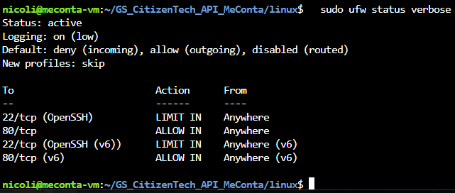

**04. Serviços** `meconta-api` (com limites de memória) e `meconta-monitor` (com a última medição no Status)

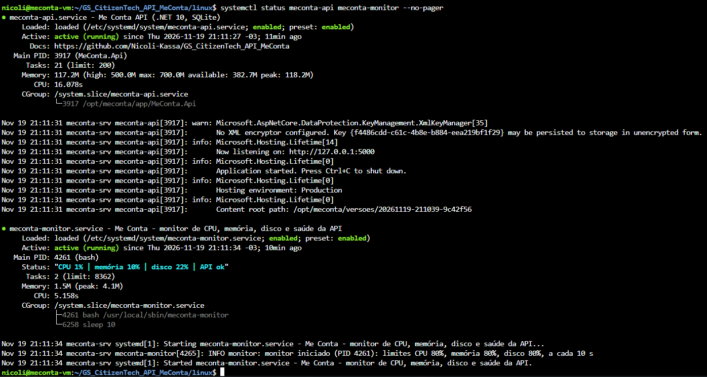

**05. Swagger da API** aberto pelo nome público

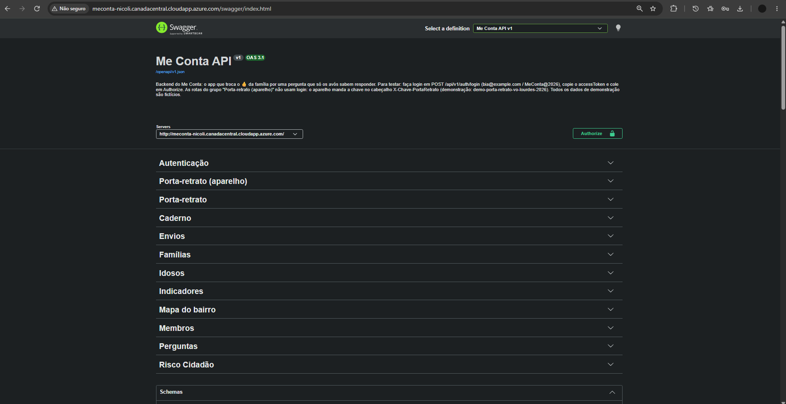

**06. Painel do servidor** (`/servidor/`)

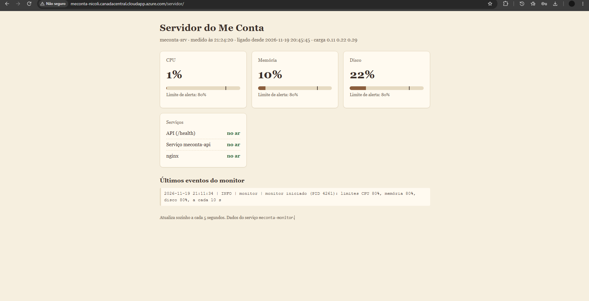

**07. Alertas no terminal e no painel** durante o teste: o monitor reinicia a API travada e o card de CPU fica vermelho

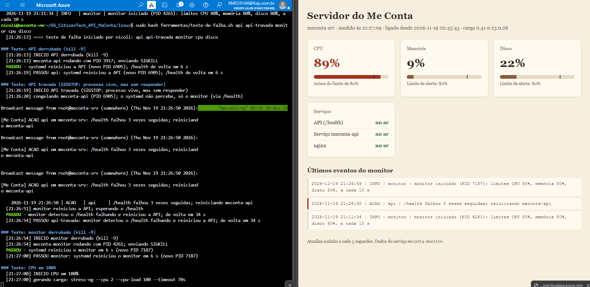

**08. Resumo do teste de falha**

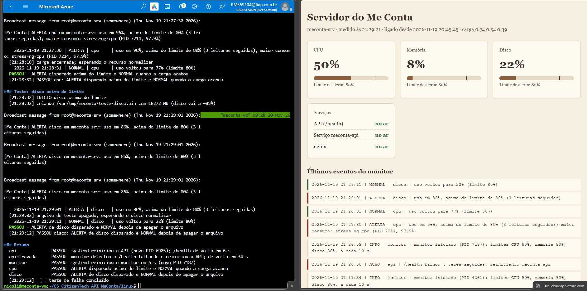

**09. Depois do reboot:** tudo voltou sozinho

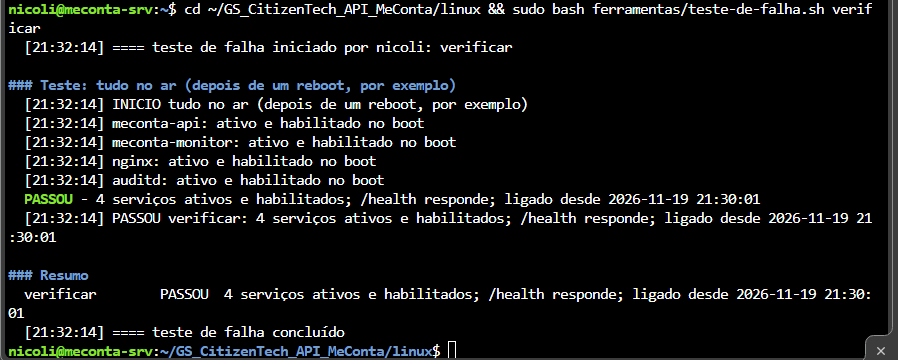

**10. Relatório de auditoria** (provisionamento, acessos à API) e o painel com o histórico de ALERTA/NORMAL

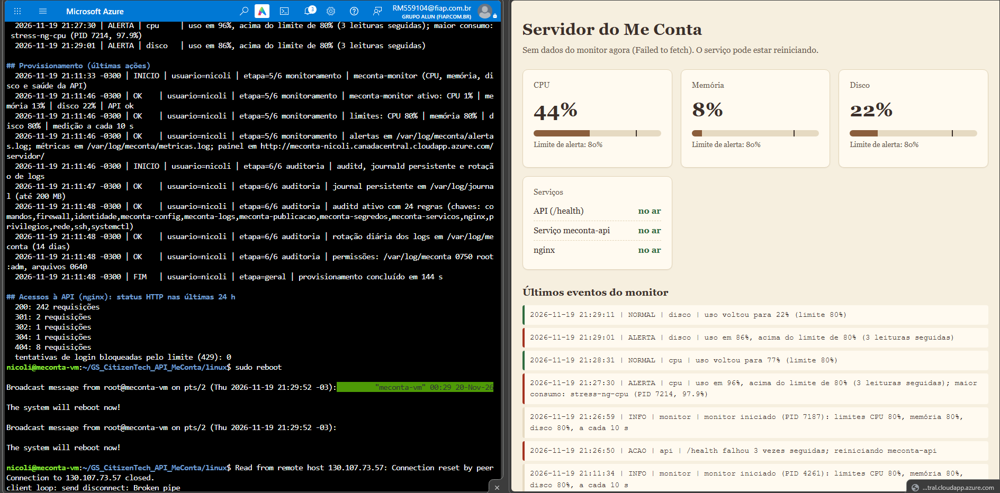

**11. Rede, DNS, hostname e firewall** num comando só

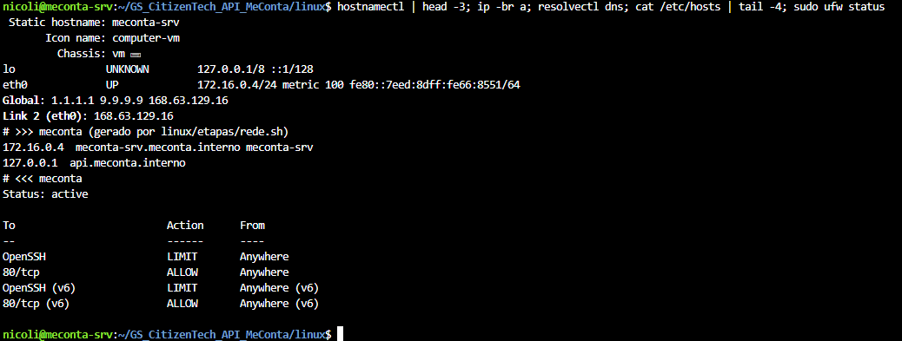

## Decisões e limites

- **Por que nuvem:** o computador de desenvolvimento não aguenta uma VM local junto com a API. A VM usa o crédito do Azure for Students, na única região que a assinatura de estudante liberou com capacidade (Canada Central).
- **Por que SQLite no servidor:** o SQL Server pede pelo menos 2 GB de RAM só para ele, e a VM roda tudo junto (API, nginx, monitor). A API já aceita os dois bancos pela configuração (`Banco__Provedor`); o código é o mesmo.
- **IP e DNS no Azure:** quem entrega o IP é a plataforma. Na primeira VM, a troca do IP para estático na NIC falhou e deixou a máquina sem rede; ela foi recriada e o IP ficou como o Azure entrega (reservado enquanto a VM existir). Por isso o script lê e confere o IP, e só grava o IP fixo no netplan quando os dois lados (NIC e configuração) batem, com rollback automático.
- **HTTP sem TLS:** o protótipo usa a porta 80. O próximo passo é um certificado Let's Encrypt (certbot) para o nome público.
- **Dados:** só dados fictícios de demonstração. Nenhum dado pessoal real no servidor.
